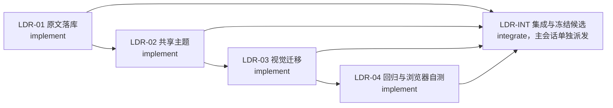

# Linear 暗色视觉改造：技术方案与实施计划

- 父任务：`linear-design-restyle-20261121`；环节：solution-designer；派发轮次：3（仅批准的技术机制R1修订）。
- designVersion：`linear-restyle-design-v1-R1`；planVersion：`linear-restyle-plan-v1.1`；AC/DoD冻结定义仍为`linear-restyle-ac-dod-v1`。
- 状态：**READY_FOR_APPROVAL**。主会话提供的真实批准来源已核验，用户已批准机制修订并已按方案A定稿；本状态仅为方案交接，不表示开发失败已修复、应用核验通过或允许发布。
- 本轮仅修改本方案文件。没有修改应用、根 DESIGN.md、测试、依赖、规则、数据库或已有设计/核验记录；没有启动服务、执行测试、提交或派发会话。

### v0.2 → v1历史与批准来源

轮次1形成v0.2方案与草案，SHA256为`0fffa5c35d469a97f0bf616ec24ac34e28362cb62bb6dda6d13fa56fbb2476d4`，交接回调Turn `282ef4e1-9e14-5598-a8e9-95dad53bf973`。轮次2由主会话转交2026-11-21内置AskUserQuestion真实回答：Q-VIS-01为“接受深色悬停字 (Recommended)”，方案与本次AC/DoD为“批准并继续 (Recommended)”。批准内容及限定范围见§2.2；旧评审要求按不同历史任务核定见§9。v1沿已批准v0.2内容定稿，只更新决定状态、版本及分轮调度表述，不增加功能、条件、文件、环节或预算。批准定义不等于执行通过，应用核验仍NOT_RUN。

### v1 → v1-R1技术修订来源

原v1文件SHA256为`56b73fff57c9ca7d2b1a8ed47ea926afadb315e89a7aed66d8ae1bab2e584f26`；原计划`linear-restyle-plan-v1`保留历史。主会话核对原开发会话`f6239994-eaf6-5794-a870-0942f3ccb358`轮次1结果Turn `6bbf6710-b8af-52ee-a25a-aff27cd0ad4d`及失败日志后，转交2026-11-21内置AskUserQuestion Q-LDR-02-ALGORITHM真实回答“允许最小修订 (Recommended)”。用户批准仅用纯函数调用现有暗色算法后恢复指定seed值，保留色板、4.5阈值及所有实际颜色断言，只替换新增测试中的函数引用相等断言；原设计和Sonus会话继续，不增加依赖、业务、节点关系或会话数量。

本次纠正“直接darkAlgorithm配token即可恢复所有指定seed”的已证实错误假设，**不让错误颜色合法化**。design修订为v1-R1、plan为v1.1；AC/DoD定义v1及全部观察性要求、writeScope、稳定任务与门禁不变。开发部分源码/失败日志原样保留；技术proof不是应用自测或验收通过。详细机制见§3.1.1、当前失败/未测证据见§10.3。

## 1. 可直接展示的摘要

推荐保留 React / Ant Design 现有组件与所有业务交互，只更换视觉系统：近黑画布、四级炭灰表面、细边框、浅灰文字、稀疏的 Linear 薰衣草蓝主按钮/焦点/链接。将原营销规范完整引入根 DESIGN.md；采用一个纯 TypeScript token 模块同时供 antd ThemeConfig 和根 CSS 变量使用，不增加依赖。登录区、示意书封、仪表盘和图表取消绿色/暖纸/金色及装饰渐变；后台表格、弹窗、表单、标签使用规范 token 的场景延伸。

已确认采用Q-VIS-01方案A：主按钮hover保持#828fff背景、改用canvas深色字（配色计算7.275:1），焦点环采用实色2px，有效提示用ink-subtle。原规范白字hover的2.868:1失败事实保留，但不修改上游原文。主会话已核定旧DOD-11及提醒评审要求约束各自不同历史任务，本次独立评审未启用/跳过，不计PASS；不改写旧门禁和旧核验结论。一个开发会话先串行实现LDR-01–04并返回主会话，主会话核对局部证据后再给同会话单独派发LDR-INT integrate，冻结候选后派发独立验收。当前LDR-01原文落库已由主会话独立只读核对；LDR-02部分实现typecheck通过，但新增单测9过2失败，原指定seed被antd重新生成。R1采用仅调用darkAlgorithm的纯包装恢复六个seed，不改变原色值或放宽断言；本轮只读proof支持该机制，尚未写入应用或重跑测试。LDR-03/04、全量回归和浏览器未运行；颜色计算/机制proof不是应用验收。

## 2. 输入、授权及证据边界

### 2.1 固定输入

| 输入 | 版本/来源 | 已核实情况 |
|---|---|---|
| 工作区 | `/Users/duff/Documents/Lingma-Demo/qoder-pl-test10` | git main；HEAD `c1e30e646bf7bd8c39e59b353a001f79192ca9f6`；写入本文件前 `git status --short` 无输出 |
| 规范原文 | `/tmp/linear-DESIGN.md` | 完整读取含 front matter；`shasum -a 256` 为 `30bd30e72c48a16e4bdbd010f2d1c85fab657c6fae3cc85389399aab10f9cb5f`；无需重新下载 |
| 来源网页 | `https://github.com/VoltAgent/awesome-design-md/blob/main/design-md/linear.app/DESIGN.md` | 主会话获取 main 分支，2026-11-21；上游 commit 未提供，不伪造；内容由 SHA 固定 |
| 原始下载 URL | `https://raw.githubusercontent.com/VoltAgent/awesome-design-md/main/design-md/linear.app/DESIGN.md` | 作为来源追溯，不在应用运行时请求 |
| 仓库规则 | `/Users/duff/Documents/Lingma-Demo/qoder-pl-test10/AGENTS.md` | 已读；本轮只读，设计文件唯一写例外由交接明确授权 |
| 基础契约 | `/Users/duff/Documents/Lingma-Demo/qoder-pl-test10/docs/design/solution-design.md` | 相关前端 §10 已读；批准版本 design-v0.1-R1 来源见 approval-record |
| 原 AC/DoD | `/Users/duff/Documents/Lingma-Demo/qoder-pl-test10/docs/design/ac-dod.md` | 已读；标题保留 v0.1 草案，批准记录将基础定义确认为 v1；不能据标题推定未批准 |
| 提醒增量 | `/Users/duff/Documents/Lingma-Demo/qoder-pl-test10/docs/design/reminder-increment.md` | 已读；AC/DoD v1.1、计划 v1.5；业务与旧证据不改动 |
| 批准来源 | `/Users/duff/Documents/Lingma-Demo/qoder-pl-test10/docs/design/approval-record.md` | 已读；基础任务 lib-mgmt-20261117、提醒任务 lib-borrow-reminder-p1 与本次样式任务不同 |
| 本次定义 | 主会话草案v0.1 → 轮次1细化v0.2 → 本次冻结v1 | 2026-11-21用户真实回答“批准并继续 (Recommended)”，轮次2主会话转交；定义获批不当作执行PASS |

### 2.2 用户已确认，非本轮猜测

selectionId `3ad760f3-f0d6-4897-b592-559abededf2e` 的主会话卡片确认：方案 ultimate、开发 smodel、验收 qmodel_latest；关闭独立评审。终点是本机样式实现和独立验收，不包括发布。

主会话转交 AskMe 决定：D1 仅暗色；D2 保留暗底低饱和错误/警告语义色，仅状态/校验，成功沿用 #27a644；D3 系统字体及中文回退，不加字体依赖；D4 根 DESIGN.md 原文保留并标来源/分支/日期/SHA，不能破坏 YAML。

2026-11-21主会话转交的内置AskUserQuestion真实返回已核验：

- Q-VIS-01：“接受深色悬停字 (Recommended)”；采用A，原DESIGN.md不改。
- 方案与范围：“批准并继续 (Recommended)”；批准v0.2方案及本次AC/DoD，允许规范原文引入、单源暗色主题、全站视觉迁移、有效文字对比度≥4.5、本方案列出的前端源码/新增回归测试/本次核验文件、全量测试与真实浏览器验证。
- 执行范围：一个Sonus（smodel）开发会话串行实现并分轮集成，一个Qwen4-Max（qmodel_latest）独立验收会话；selectionId不变，独立评审关闭。不改业务、旧契约、依赖或数据库，不提交或部署。
- 模型目录由主会话复核：workspaceId=`f1c40b80-c306-474e-9051-af7c1b2a0de1`；轮次2getModels fetchedAt=`1795246039857`，轮次3最新为`1795247328015`，ultimate仍enabled，价格倍率2；无模型更换。
- 轮次3 Q-LDR-02-ALGORITHM：“允许最小修订 (Recommended)”；批准方案A纯暗色算法包装恢复seed，原实际颜色/alias/CSS映射/对比度断言全部保留，只替换新增算法引用相等的机制断言；旧契约、业务、依赖、writeScope、节点关系和会话数不变。

上述授权用于主会话后续派发，并不扩大本方案环节权限：本轮只允许原生Edit等工具修改本文件，其他全部只读；可进行小型只读机制诊断，不启动服务、不跑项目测试、不修改应用/node_modules/根DESIGN/测试/既有核验，不安装依赖、不提交、不派发会话。保留开发现有7个已授权部分文件，不覆盖或回滚。本计划不能替代宿主权限弹窗。

## 3. 推荐方案、替代方案与适用性

### 3.1 推荐：一个 token 源、antd darkAlgorithm、串行视觉迁移

`/Users/duff/Documents/Lingma-Demo/qoder-pl-test10/frontend/src/styles/linearTheme.ts`原计划新建，现已由开发部分创建；本方案轮次3只读核验，不改其源码：

1. 导出不可变 `linearTokens`：按规范保留 colors / typography / rounded / spacing 命名，并单列后台延伸 tokens。
2. 导出 `linearTheme: ThemeConfig`：algorithm采用§3.1.1的稳定纯函数`linearDarkAlgorithm`，仅调用现有`theme.darkAlgorithm`并在返回MapToken中恢复单源指定六个seed；其余颜色alias/组件token继续显式映射。原v1直接传`theme.darkAlgorithm`并靠token恢复全部seed的假设已证实错误，不能沿用。antd 6.7.1的公开ThemeConfig.algorithm允许MappingAlgorithm函数；本次核对类型/实际格式化边界，不使用私有补丁。
3. 导出 `linearCssVariables: Record<string, string>` 与 `applyLinearCssVariables(root: HTMLElement): void`：所有 `--linear-*` 的颜色/尺寸值从同一对象产生；函数遍历 setProperty，不解析网络文件、不读身份信息、不使用 localStorage。
4. `/Users/duff/Documents/Lingma-Demo/qoder-pl-test10/frontend/src/main.tsx` 在 createRoot/render 前同步调用 `applyLinearCssVariables(document.documentElement)`；App 只传 `linearTheme`。CSS 不再重复定义十六进制颜色。
5. `/Users/duff/Documents/Lingma-Demo/qoder-pl-test10/frontend/src/styles/global.css` 只消费变量；`:root { color-scheme: dark; }`；html/body/root/app 使用 canvas、ink、系统字体；body margin 0。首次组件渲染、Suspense、登录态检查和 portal 都能继承根变量。

数据流：本地固定 token 对象 → ThemeConfig → ConfigProvider / antd App → antd 组件；同一对象 → 根 style CSS 变量 → 全局与 feature CSS / 内联 var 引用。应用 API、Query 缓存、认证、路由和数据所有权不变。新增 styles 模块无业务依赖；app/auth/features 可以使用其视觉常量，不能反向导入业务层。

`applyLinearCssVariables` 可重复调用，值相同且不会生成多个 style 节点；只在 main 初始化，不在 render 中进行 DOM 写入。pure token 导入不依赖 document，Vitest 可直接验证。直接渲染组件的旧单测不依赖 main 的副作用；新视觉集成测试须显式初始化变量和包 ConfigProvider。应用没有 SSR，不引入 SSR 支持。

### 3.1.1 R1：公开算法扩展、准确恢复seed及行为核验

**已核实机制：**本机`/Users/duff/Documents/Lingma-Demo/qoder-pl-test10/frontend/node_modules/antd/es/config-provider/context.d.ts`第92–108行允许`algorithm?: MappingAlgorithm | MappingAlgorithm[]`；`/Users/duff/Documents/Lingma-Demo/qoder-pl-test10/frontend/node_modules/antd/es/theme/index.d.ts`第16行公开darkAlgorithm的函数类型。MappingAlgorithm输入SeedToken和可选前序MapToken，返回MapToken。无需新增依赖或从antd私有目录导入类型，生产函数可用`typeof theme.darkAlgorithm`标注。

本机`/Users/duff/Documents/Lingma-Demo/qoder-pl-test10/frontend/node_modules/antd/es/theme/util/alias.js`第17–19行删除config override中的全部seed键，故非seed alias可显式覆盖，但被darkAlgorithm改写的colorPrimary/colorLink/四个语义seed不能靠常规token重置。`/Users/duff/Documents/Lingma-Demo/qoder-pl-test10/frontend/node_modules/antd/es/theme/getDesignToken.js`第12–14行与`/Users/duff/Documents/Lingma-Demo/qoder-pl-test10/frontend/node_modules/antd/es/theme/useToken.js`第49–61行均使用同一格式化边界。恢复值必须进入**算法返回的MapToken**，才能保留到实际全局消费边界；不通过CSS强制、函数引用伪断言或改期望色值规避。

后续开发仅在已有`linearTheme.ts`内添加以下机制（本轮不改应用）：

```ts
const linearSeedColors = {
  colorPrimary: linearTokens.colors.primary,
  colorLink: linearTokens.colors['primary-hover'],
  colorSuccess: linearTokens.status.success.foreground,
  colorError: linearTokens.status.error.foreground,
  colorWarning: linearTokens.status.warning.foreground,
  colorInfo: linearTokens.status.info.foreground,
} as const;

export const linearDarkAlgorithm: typeof theme.darkAlgorithm = (seed, mapToken) => {
  const derived = theme.darkAlgorithm(seed, mapToken);
  return { ...derived, ...linearSeedColors };
};
```

在现有ThemeConfig中仅将`algorithm: theme.darkAlgorithm`改为`algorithm: linearDarkAlgorithm`；同一六个seed映射可在现有token中共用`linearSeedColors`，但必须保留其它alias/components/CSS变量及所有指定值。只恢复以上六个被改写seed，不任意覆盖整套derived map。colorBgBase/colorTextBase的原值与输入、其它显式alias继续现机制，无新增配色。

约束：包装只显式调用`theme.darkAlgorithm`，传递其公开入参；不显式调用defaultAlgorithm/compactAlgorithm、不混入算法数组、不增加亮色模式、不递归引用linearTheme、不读写DOM/身份/网络、不修改入参或dark返回对象。对象展开返回新MapToken，模块级稳定函数，不在render中创建。darkAlgorithm内部为字体/尺寸等共享派生调用其自身默认基础实现是库内部正常逻辑，不是启用亮色模式；不修改node_modules。

**测试调整边界：**仅替换`/Users/duff/Documents/Lingma-Demo/qoder-pl-test10/frontend/src/styles/__tests__/linearTheme.test.ts`第20–21行新增的`expect(linearTheme.algorithm).toBe(theme.darkAlgorithm)`机制断言。原第61–80行getDesignToken精确颜色/alias/components、第97–115行精确语义值/CSS与4.5对比度、其余映射/幂等测试全部保留，不改旧业务测试，不mock最终getDesignToken结果。

建议用以下行为核验替代引用相等（同一新增测试文件内，无新增文件或门禁）：

```ts
const seed = Object.freeze({ ...theme.defaultSeed, ...linearTheme.token });
const snapshot = JSON.stringify(seed);
const restored = {
  colorPrimary: linearTokens.colors.primary,
  colorLink: linearTokens.colors['primary-hover'],
  colorSuccess: linearTokens.status.success.foreground,
  colorError: linearTokens.status.error.foreground,
  colorWarning: linearTokens.status.warning.foreground,
  colorInfo: linearTokens.status.info.foreground,
};
const actual = linearDarkAlgorithm(seed);
expect(actual).toEqual({ ...theme.darkAlgorithm(seed), ...restored });
expect(linearDarkAlgorithm(seed)).toEqual(actual);
expect(JSON.stringify(seed)).toBe(snapshot);
```

测试可用保持原实现call-through的`vi.spyOn(theme, 'darkAlgorithm')`证明包装调用暗色派生一次，并在finally恢复spy；不能mockReturnValue制造预期色。比较未恢复的dark派生属性、变更fontSize/borderRadius后的保留性质及可选map参数透传可强化行为证明，仍是原单源/仅暗色/纯函数要求的验证细化。包装自身的结果比较不能替代仍须执行的getDesignToken精确输出、组件token检查与真实浏览器useToken边界验证。

**本轮只读proof：**在frontend目录用Node原生读取已存在纯token模块并创建内存包装，调用公开getDesignToken；六个seed均恢复指定值，478个未恢复属性与darkAlgorithm结果一致，重复调用确定、冻结seed输入不变，现有ThemeConfig.token全部配置键的最终输出差异为0。无文件写入、服务启动或项目测试；结果只支持本机6.7.1机制可行，**不能把开发2个失败重标PASS**。proof具体输入/输出、原失败和重验要求见§10.3。

### 3.2 不选的替代方案

- **CSS 作为唯一源，App 用 getComputedStyle 读取主题**：可以消除字面重复，但加载顺序、缺失变量、jsdom CSS 求值及暗色算法数值 seed 处理更脆弱，须额外校验与恢复机制；不推荐。
- **antd token 与 CSS 各写一份值**：改动少但不能满足 AC-2 的共用与一处定义，容易漂移；不选。
- **更换组件库/重写布局**：会扩大业务交互回归和依赖范围，非目标。

TS → 根变量是本项目最小稳定选择。规范原文仍是参考，不是运行时依赖；本地 token 是该 SHA 的可测试实现映射。不会执行规范末尾建议的 `npx @google/design.md lint`，它不构成本项目门禁且涉及未批准包。

### 3.3 营销规范适用/延伸/不引入

| 规范项 | 后台处理 |
|---|---|
| canvas、surface 梯级、hairline、ink 梯级、8px 按钮/输入圆角、12px 卡片、系统字体 | 直接适用 |
| 稀疏 primary、无氛围渐变、靠表面抬升而非阴影 | 直接适用；品牌图标/主操作/焦点/链接允许 primary，不做整卡填充 |
| 80/56px display、96px marketing section、1280px 最大内容宽 | 不强套到数据后台；保留 token，但页面标题用22/28px、面板24px、列表14px；保留现有流式宽度/分页/横滚 |
| pricing tabs/cards、feature-card、top-nav、status-badge、text-input | 分别投影为 Tabs/Menu、业务面板、Header、Tag、Input/Select/DatePicker/表单 |
| 白色 inverse CTA | 原文/token 保留，不在仅暗色项目使用 |
| screenshot 主角、customer logos、pricing comparison、testimonial、footer link grid | 不适用本次后台任务；不增加伪截图、营销区、报价页或外部素材 |
| 响应式 marketing hamburger | 保留现有 Sider collapsible 与 lg breakpoint，不新写路由或交互；保留现有窄屏布局修复 |
| chart/表格/Modal/Alert/错误校验 | 规范缺项，按下文 token 延伸；语义红/琥珀源于已确认 D2，不新增装饰色相 |
| 50% primary-focus 描边、白字 primary-hover | 冲突已通过Q-VIS-01方案A解决设计选择：实色2px焦点环、hover canvas字，有效提示ink-subtle；原规范保留，AC阈值不降低，运行时仍须核验 |

## 4. 完整 token 映射

### 4.1 colors → CSS 与 antd 全局 token

以下固定值与CSS/组件映射在R1中全部不变。非seed颜色alias仍须显式传入；colorPrimary、colorLink及colorSuccess/Error/Warning/Info这六个seed必须由§3.1.1包装在dark派生返回值中恢复，不能假设常规ThemeConfig.token能覆盖其dark生成值。六个输入与恢复映射均来自现有linearTokens，不重复色值、不删除实际颜色断言。

| 规范 token | 固定值 | CSS 变量 | ThemeConfig.token / seed恢复（§3.1.1）/ 用途 |
|---|---|---|---|
| primary | #5e6ad2 | --linear-primary | colorPrimary；主按钮默认背景、品牌标记 |
| on-primary | #ffffff | --linear-on-primary | Button.primaryColor；仅默认/pressed 按钮字 |
| primary-hover | #828fff | --linear-primary-hover | colorPrimaryHover；colorLink/colorLinkHover 默认使用此可读级，hover 主按钮背景 |
| primary-focus | #5e69d1 | --linear-primary-focus | colorPrimaryActive/colorPrimaryBorder；输入 activeBorderColor；键盘焦点 |
| ink | #f7f8f8 | --linear-ink | colorTextBase/colorText；标题/正文 |
| ink-muted | #d0d6e0 | --linear-ink-muted | colorTextSecondary；次级文案 |
| ink-subtle | #8a8f98 | --linear-ink-subtle | colorTextTertiary/colorTextPlaceholder；元信息/提示/轴文字 |
| ink-tertiary | #62666d | --linear-ink-tertiary | colorTextQuaternary/colorTextDisabled；仅真正 disabled 或非信息装饰，不用于脚注/有效提示 |
| canvas | #010102 | --linear-canvas | colorBgBase/colorBgLayout；html/body/页面底、导航底 |
| surface-1 | #0f1011 | --linear-surface-1 | colorBgContainer；常规卡片/输入 |
| surface-2 | #141516 | --linear-surface-2 | colorFillTertiary；Menu选中、表格头/hover、嵌套面板 |
| surface-3 | #18191a | --linear-surface-3 | colorBgElevated/colorFillSecondary；Modal、下拉、Tooltip基础表面 |
| surface-4 | #191a1b | --linear-surface-4 | colorFill/colorFillQuaternary/colorBgSpotlight；活跃hover/更高一层 |
| hairline | #23252a | --linear-hairline | colorBorderSecondary/colorSplit；装饰分割/面板边框 |
| hairline-strong | #34343a | --linear-hairline-strong | colorBorder；输入/嵌套边界 |
| hairline-tertiary | #3e3e44 | --linear-hairline-tertiary | 无独立全局同名项；嵌套hover边界/滚动条 |
| inverse-canvas | #ffffff | --linear-inverse-canvas | 仅保留，不启用逆色块 |
| inverse-surface-1 | #f5f6f6 | --linear-inverse-surface-1 | 仅保留，不映射暗色组件 |
| inverse-surface-2 | #f6f7f7 | --linear-inverse-surface-2 | 仅保留，不映射暗色组件 |
| inverse-ink | #000000 | --linear-inverse-ink | 仅保留，不作为页面 canvas |
| brand-secure | #7a7fad | --linear-brand-secure | 后台信息状态及数据序列；不做品牌背景 |
| semantic-success | #27a644 | --linear-success | colorSuccess；状态/成功告警，不能用于普通数字卡装饰 |
| semantic-overlay | #000000 | --linear-overlay | colorBgMask = rgba(0,0,0,0.72)，遮罩透明度为后台延伸；不作页面底 |

其余常用全局项：colorLinkActive = primary-hover（保持小字号链接可读）；colorTextLightSolid = on-primary（只有深色实心主按钮使用）；colorBgContainerDisabled = surface-2；colorIcon = ink-subtle；colorIconHover = ink-muted；boxShadow / boxShadowSecondary / boxShadowTertiary 均 none；controlOutline = primary-focus；controlOutlineWidth = 2；lineWidthFocus = 2；lineWidth = 1。凡是算法默认造成文字、浮层或色阶偏差，按组件范围显式覆盖，不用通配 `* { color: ... !important }`。

### 4.2 typography / radius / spacing

字体栈统一：`'SF Pro Display', -apple-system, BlinkMacSystemFont, system-ui, 'Segoe UI', Roboto, 'PingFang SC', 'Hiragino Sans GB', 'Microsoft YaHei', sans-serif`。
等宽：`ui-monospace, 'SF Mono', SFMono-Regular, Menlo, Consolas, 'Liberation Mono', monospace`。不请求在线字体，不新增 npm 包。

每个排版 token 在 TS 中保存 fontSize/fontWeight/lineHeight/letterSpacing；生成 `--linear-<name>-size/weight/line-height/tracking`，family 共用 `--linear-font-sans`，mono 用 `--linear-font-mono`。

| token | size / weight / lineHeight / tracking | 应用投影 |
|---|---|---|
| display-xl | 80px / 600 / 1.05 / -3px | 保留，后台不默认使用 |
| display-lg | 56px / 600 / 1.10 / -1.8px | 保留，后台不默认使用 |
| display-md | 40px / 600 / 1.15 / -1px | 登录品牌标题（窄屏降28px）；fontSizeHeading1/lineHeightHeading1 |
| headline | 28px / 600 / 1.20 / -0.6px | 页面主标题；fontSizeHeading2/lineHeightHeading2 |
| card-title | 22px / 500 / 1.25 / -0.4px | 常见 level3 标题；fontSizeHeading3/lineHeightHeading3 |
| subhead | 20px / 400 / 1.40 / -0.2px | 次级标题；fontSizeHeading4/lineHeightHeading4 |
| body-lg | 18px / 400 / 1.50 / -0.1px | 引导段；fontSizeHeading5/lineHeightHeading5 |
| body | 16px / 400 / 1.50 / -0.05px | token.fontSize=16、lineHeight=1.5、fontFamily=系统栈 |
| body-sm | 14px / 400 / 1.50 / 0 | 表格/菜单/紧凑表单；fontSizeSM=14，Table.cellFontSize=14 |
| caption | 12px / 400 / 1.40 / 0 | 标签/脚注；不得配 ink-tertiary |
| button | 14px / 500 / 1.20 / 0 | Button.contentFontSize/contentLineHeight/fontWeight |
| eyebrow | 13px / 500 / 1.30 / 0.4px | 少量品牌副标题/元信息，不全局中文字间距拉宽 |
| mono | 13px / 400 / 1.50 / 0 | ISBN/条码/卡号；fontFamilyCode |

antd 标题全局 fontWeightStrong=600；需 card-title 的 500 由专用 class 控制。现有明确字号不强制全部改写，但脱离刻度的纯装饰标题/元信息向上述刻度收敛；不缩小控制目标来追求密度。

| rounded | 值 | CSS | antd/应用 |
|---|---|---|---|
| xs | 4px | --linear-radius-xs | borderRadiusXS；小标记/条形顶角 |
| sm | 6px | --linear-radius-sm | borderRadiusSM；行内小块 |
| md | 8px | --linear-radius-md | borderRadius；Button/Input/Select、常规Tabs/表头 |
| lg | 12px | --linear-radius-lg | borderRadiusLG；Card/Modal/业务面板 |
| xl | 16px | --linear-radius-xl | 仅少量大登录品牌容器，非每个后台卡片 |
| xxl | 24px | --linear-radius-xxl | 保留，不扩成普遍圆角 |
| pill/full | 9999px | --linear-radius-pill / --linear-radius-full | 状态Tag/Avatar；不得 pill-round 操作按钮 |

| spacing | 值 | CSS | 投影 |
|---|---|---|---|
| xxs | 4px | --linear-space-xxs | marginXXS/paddingXXS |
| xs | 8px | --linear-space-xs | marginXS/paddingXS |
| sm | 12px | --linear-space-sm | marginSM/paddingSM |
| md | 16px | --linear-space-md | margin/padding |
| lg | 24px | --linear-space-lg | marginLG/paddingLG；Card.bodyPadding、页面容器 |
| xl | 32px | --linear-space-xl | marginXL；大块内距 |
| xxl | 48px | --linear-space-xxl | marginXXL；登录品牌内距 |
| section | 96px | --linear-space-section | 保留；数据后台不用于每段分隔 |

组件明确的 14px 按钮水平内距、2px/8px Tag padding 来源于 components token，不强行取整为 spacing。controlHeight=40、controlHeightLG=44；小按钮维持现有 small 语义，在触控窄屏通过按钮/输入视觉 min-height 增大，不改事件逻辑。

### 4.3 后台语义色：具体值、来源与边界

错误/警告的色相来源是已存在项目语义色，不再制造第三个装饰色板。低饱和派生方式（sRGB通道混合，每通道 round）：

- error = 50% 原项目错误 #b23a32 + 50% 规范 ink-muted #d0d6e0 = **#c18889**。
- warning = 50% 原项目警告 #c9861d + 50% 规范 ink-muted #d0d6e0 = **#cdae7f**。
- success = 规范 **#27a644** 原值（D2 已确认例外，不再降低饱和度）。
- info = 规范 **#7a7fad** brand-secure。processing 标签为中性信息状态，不新增标准 antd 蓝色色相。

旧 seed 只在单一 token 模块的派生来源说明中保留，不在页面/CSS回退里出现。实现可保存最终值及来源注释，不需要新增颜色计算库。

| status | colorX / --linear-X | colorXBg：12% foreground 叠 surface-2 | colorXBorder：32% foreground 叠 surface-2 |
|---|---|---|---|
| success | #27a644 | #16261c | #1a4325 |
| error | #c18889 | #292324 | #4b3a3b |
| warning | #cdae7f | #2a2723 | #4f4638 |
| info | #7a7fad | #141516（直接使用surface-2，非12%染色） | #34343a（hairline-strong） |

info不使用彩色叠底：实算12% brand-secure叠surface-2会得到#202228，文字仅4.139:1，不满足4.5，故以规范中性surface-2替代。其他三类沿用12%/32%派生背景/边框。

生成 `--linear-{status}` / `--linear-{status}-bg` / `--linear-{status}-border`。colorSuccess/Error/Warning/Info四个seed由R1纯包装恢复上表foreground；现有Bg/BgHover/Border/BorderHover/Text/TextHover/TextActive/Active/Hover等非seed alias保持显式映射。文字均维持上表foreground，背景/边框用上表背景/边框；具体hover可表面抬升，不靠更饱和颜色。禁止纯色 warning/error/success 实心底配白小字（success白字仅3.170:1，其他更低）；状态Tag使用outlined/filled而非solid。真正danger实心操作按钮使用Button.dangerColor=canvas，以error背景对深字7.104:1满足AA，不能误套主按钮的白字。

作用边界：Tag、字段错误、Alert/Message/Notification 的业务结果及已有危险确认控件可保持语义；角色/分类/图书数量/排名/普通概览不能用金/绿/红装饰。Unread Badge 使用 surface-4 + ink 的中性计数，保留 count/offset/图标class/aria-label。

逾期仍用 error Tag 加“逾期 N 天”明确文本；保留 `circ-row-overdue`、`circ-due-overdue` 类名，但行底采用 surface-2、日期采用 ink/字重600而非整行红染。AC-LOAN-07 的“记录标红”由红色语义Tag满足；原文只明确标签，旧CSS的红底/红日期不是更改业务规则。仪表盘逾期数字、卡片边线、跳转按钮不做红装饰：普通 ink数字、hairline边线、正常链接，保留标签/标题“逾期未还”和图标、数据、目标路由。Dashboard 的 `danger` 导航装饰可移除，真正停用/删除/确认操作保留 danger 状态。

### 4.4 对比度：已执行的计算证据

计算公式：sRGB通道归一化；c<=0.04045 时 c/12.92，否则 ((c+0.055)/1.055)^2.4；L=0.2126R+0.7152G+0.0722B；ratio=(Lmax+0.05)/(Lmin+0.05)。轮次1用Node只读计算，轮次2沿用其未变化的配色输入证据；无生产运行/截图；保留3位小数，结果是**配色设计证据**不是页面验收结果。

| foreground | canvas | surface-1 | surface-2 | surface-3 | surface-4 |
|---|---:|---:|---:|---:|---:|
| ink #f7f8f8 | 19.610 | 17.902 | 17.184 | 16.547 | 16.381 |
| ink-muted #d0d6e0 | 14.284 | 13.040 | 12.517 | 12.053 | 11.932 |
| ink-subtle #8a8f98 | 6.421 | 5.862 | 5.627 | 5.418 | 5.364 |
| ink-tertiary #62666d | 3.617 | 3.302 | 3.170 | 3.052 | 3.022 |
| primary #5e6ad2 | 4.439 | 4.053 | 3.890 | 3.746 | 3.708 |
| primary-hover #828fff | 7.275 | 6.641 | 6.375 | 6.139 | 6.077 |
| brand-secure #7a7fad | 5.431 | 4.958 | 4.759 | 4.583 | 4.537 |
| success #27a644 | 6.581 | 6.008 | 5.767 | 5.553 | 5.498 |
| error #c18889 | 7.104 | 6.485 | 6.225 | 5.995 | 5.934 |
| warning #cdae7f | 9.892 | 9.031 | 8.669 | 8.347 | 8.263 |

错误/警告/成功在派生背景上的标签文字分别 **5.257 / 7.047 / 4.988**，通过4.5阈值。info使用中性surface-2标签底，实算 **4.759**；最坏surface-4为4.537，margin很小，不得再给文字opacity。原12%彩色info底为4.139，已明确弃用；这些是配色计算，不是运行时验收（下方矩阵仍为NOT_RUN）。

已知**不满足**项（来自上游原配色，不代表应用已改）：

- 白字 #ffffff 对 primary 默认：4.700；pressed #5e69d1：4.754；hover #828fff：**2.868，FAIL**。
- 原 50% primary-focus ring 合成在 canvas/surface 时约1.831–1.876；不是可靠的3:1可见键盘边界。推荐2px实色 #5e69d1 ring，surface-4上3.666；禁用和装饰hairline不宣称符合非文本对比度全套标准。
- ink-tertiary 不能作为有效说明/表格文字；primary 不能直接作14px链接文字。改用ink-subtle和primary-hover，保留原 token 但限定用途。

Q-VIS-01已获用户确认采用方案A：hover canvas字 + 实色focus ring。CSS定向覆盖主色实心按钮 hover 字色，不能误影响danger实心按钮；antd v6 实际class可核对 `.ant-btn-color-primary.ant-btn-variant-solid`，测试须验证默认/hover/pressed，不能只测背景。没有新增色相、没有降低4.5阈值。

### 4.5 组件 token 与 CSS 补充契约

全局token形成默认；components 中适用的 SharedToken 可局部覆盖以避免误伤其他控件。下列字段已核对本机 antd 6.7.1 的对应 style/token.d.ts 或 style/index.d.ts；最终 typecheck 是执行门禁。

| 后台组件 / 上游 component | ThemeConfig.components 明确映射 | CSS必要补充与状态 |
|---|---|---|
| Layout / top-nav | bodyBg=canvas；siderBg/headerBg=canvas；headerColor=ink；triggerBg=surface-2；triggerColor=ink-muted；headerHeight保留64以免minHeight计算漂移 | Sider/Header分割hairline；原 token.colorBgContainer 作为文字的用法必须改成colorText。Sider232/折叠/窄屏用户名约束保留 |
| Menu / pricing-tab | darkItemBg=canvas；darkSubMenuItemBg/darkPopupBg=surface-3；darkItemColor=ink-subtle；darkItemHoverColor/darkItemSelectedColor=ink；darkItemHoverBg/darkItemSelectedBg=surface-2；darkItemDisabledColor=ink-tertiary；itemBorderRadius=8 | 选中靠surface抬升、字重和中性边线，不用primary大填充；展开/折叠选中及Tooltip均验收 |
| Button / primary,secondary,tertiary | primaryColor=on-primary；dangerColor=canvas；defaultBg=surface-1；defaultColor=ink；defaultBorderColor=hairline；defaultHoverBg=surface-2；defaultHoverColor=ink；defaultHoverBorderColor=hairline-strong；defaultActiveBg=surface-3；defaultActiveColor=ink；defaultActiveBorderColor=hairline-tertiary；fontWeight500、paddingBlock8/paddingInline14；contentFontSize14/contentLineHeight1.2；defaultShadow/primaryShadow/dangerShadow=none；textTextColor=ink、textHoverBg=surface-2 | radius8；Q-VIS-01 hover改canvas字；主CTA正常高度40/large44；键盘focus实色2px（Q-VIS-01方案A已批准）；secondary/text保留语义区别 |
| Input/InputNumber / text-input | colorBgContainer=surface-1；colorText=ink；paddingBlock8/paddingInline12；hoverBg/activeBg=surface-1；hoverBorderColor=hairline-tertiary；activeBorderColor=primary-focus；activeShadow=none；errorActiveShadow/warningActiveShadow=none | 标签/placeholder≥4.5；聚焦保留surface且有outline；密码、textarea、输入数字相同语义；禁用不装成可点击 |
| Select / text-input+pricing-tab | selectorBg=surface-1；clearBg=surface-1；optionSelectedBg=surface-2；optionSelectedColor=ink；optionSelectedFontWeight600；optionActiveBg=surface-4；hoverBorderColor=hairline-tertiary；activeBorderColor=primary-focus | 下拉surface-3；搜索/多选标签同色阶；portal不从feature局部作用域取变量 |
| DatePicker | colorBgContainer=surface-1；colorBgElevated=surface-3；colorText=ink；colorTextSecondary=ink-muted | 范围输入/日历hover按surface，today焦点保留primary；无白色popup/浅蓝选区残留；组件的实际局部日期选中背景通过本机浏览器核实 |
| Card / pricing-card,feature-card,testimonial | headerBg=surface-1；actionsBg=surface-1；bodyPadding/headerPadding24；extraColor=ink-subtle；colorBgContainer=surface-1；borderRadiusLG12 | 1px hairline，无投影；嵌套面板用surface-2。不是所有卡片32/48px |
| Table / changelog-row | headerBg/headerSortActiveBg/headerSortHoverBg=surface-2；headerColor=ink-muted；bodySortBg=surface-1；rowHoverBg/rowSelectedBg/rowExpandedBg=surface-2；rowSelectedHoverBg=surface-3；borderColor/headerSplitColor=hairline；footerBg=surface-1；footerColor=ink-muted；filterDropdownBg/filterDropdownMenuBg=surface-3；expandIconBg=surface-2；headerBorderRadius8；cellFontSize14；cellPaddingBlock12/cellPaddingInline16 | 行hover不漂白；排序/固定列/分页/横滚现有行为不变；checkbox选中强调可用primary；逾期标签非整行红 |
| Modal / product panel+overlay | contentBg/headerBg/footerBg=surface-3；titleColor=ink；titleFontSize22/titleLineHeight1.25；borderRadiusLG12；colorText=ink；colorBgMask=overlay72% | antd6容器`.ant-modal-container`（不是假定旧content类）；常规Modal及Modal.confirm/Popconfirm、footer、关闭图标全部验证 |
| Tag / status-badge | defaultBg=surface-2；defaultColor=ink-muted；borderRadiusSM=pill；fontSize12；colorBorder=hairline；success/error/warning/info的colorX/Bg/Border局部覆盖同语义表 | 无green/gold/red/blue预置Tag；`success/error/warning/processing`沿用语义类型；不传任意十六进制Tag color而产生不受控实心底；padding2px8px |
| Alert / 未定义的后台延伸 | colorXBg/colorXBorder用语义表；colorText=ink；colorTextHeading=ink；containerBorderRadius8 | 图标用语义foreground，title/description保持ink/ink-muted；成功/错误/警告信息不隐去；不能靠改type来修配色 |
| Badge / status-badge | colorError局部覆盖surface-4；colorTextLightSolid=ink（计数不是错误语义） | count/offset保持、边框hairline，读者未读数可读，不改轮询/查询 |
| Tabs / pricing tabs | itemColor=ink-subtle；itemSelectedColor/itemHoverColor/itemActiveColor=ink；inkBarColor=ink-muted；cardBg=surface-2 | active由中性底/下划线识别，不用稀疏primary作大导航填色 |
| Descriptions | labelBg=surface-2；labelColor=ink-subtle；contentColor/titleColor=ink；extraColor=ink-muted | 详情阅读正常，border与Table一致 |
| Pagination/Radio/Checkbox/Switch | 继承显式colorText/colorBgContainer/colorPrimary及darkAlgorithm；不改值/事件；按真实组件检查必要local覆写 | 普通选项按surface，主要勾选焦点允许primary；不能白字hover落入2.868冲突 |
| Message/Notification/Tooltip/Popover/Dropdown/Popconfirm | 局部colorBgElevated=surface-3、colorText=ink、colorTextSecondary=ink-muted；业务结果图标语义色 | 真实portal截图，关闭/操作链接可读，阴影none，保留确认机制 |
| Skeleton/Spin/PageLoading | Skeleton由darkAlgorithm+surface填充，Spin允许primary功能性进度；tip=ink-subtle | Skeleton活跃加载动效不算“氛围渐变”；reduced-motion保留；本次不重写加载逻辑 |
| Empty/Result403/404 | 文字继承ink/ink-subtle | stock插画可能含未theme的亮蓝/橙：公共Empty改用InboxOutlined、403用LockOutlined、404用SearchOutlined中性图标（aria-hidden）；保留状态title/action与路由行为 |

原规范 button-inverse / pricing-card-featured / product-screenshot-card / cta-banner / customer-logo-tile / footer 等全部已在上面适用性说明与token表保留。原组件text-input-focused与button-primary-pressed分别由Input.activeBorderColor与colorPrimaryActive投影；footer、customer-logo无后台新增实例。不能为了“完整映射”凭空增加业务页面。

## 5. 页面表现、影响文件与保留行为

### 5.1 用户可观察流程

- 登录：两栏布局与用户名/密码/按钮/错误文案保留。品牌区为canvas+hairline+中性产品说明，Book图标primary；移除spines装饰DOM和所有氛围渐变，取消大阴影，标题负tracking适度；小屏继续单栏。文案“借阅有序 · 书香常新”和原功能列表可保留，不做业务宣传新增。
- 主布局：侧栏/顶栏canvas，内容surface-1，嵌套表面surface-2。角色Tag中性、avatar中性surface-3，不以角色换色。品牌图标primary，用户名/退出用ink；保留232px侧栏、collapsed、未读角标、6em用户名和退出竞态修复。
- 数据页：表格/筛选/表单/详情/弹窗同一色阶。书封是现有aria-hidden示意，不再哈希彩色渐变；可保留hash和6槽映射到surface梯级/中性边线，props/title/author/尺寸/信息结构不变。
- 统计：普通数字卡统一中性，去金银铜排名装饰和边线色。借出/归还用 **ink-muted与brand-secure** 两条实色数据序列，既有图例/数量/title保留；不改趋势数据计算、数量、轴刻度、动画/滚动。排行榜bar用ink-subtle，背景surface-2；rank前三只字重或表面抬升，无奖牌色。
- 催还：案件/history卡中性，OPEN=warning、CLOSED=success Tag；登记弹窗错误/成功语义可读；不能把“电话”登记改成“已送达”。通知：未读中性surface-2与ink边线，已读surface-1，type中性，当前状态RETURNED=success、OVERDUE=error、ACTIVE=processing。
- 加载/空态/失败：保留首次Skeleton/Spin、保留旧数据loading、空文案/action、503与重试；错误请求与重试时序不改。403/404与登录检查的公共fallback也必须暗色。中断/刷新/浏览器后退恢复行为沿用当前Query与路由；视觉无持久状态迁移。
- 不新增超时、自动重试、幂等键、审计接口；原ApiError和Query恢复契约保持。没有数据库迁移/外部API/发布步骤。

### 5.2 已核实的修改目标（后续开发）

本节每个路径均绝对定位，除明确“新建”外均已通过读取/定位核实存在。没有依据只因不同文件名就推定可并行。

| ID | 绝对路径 | 改动要点 |
|---|---|---|
| F01 | `/Users/duff/Documents/Lingma-Demo/qoder-pl-test10/DESIGN.md`（新建） | 第6节来源注释，原始字节保留 |
| F02 | `/Users/duff/Documents/Lingma-Demo/qoder-pl-test10/frontend/src/styles/linearTheme.ts`（新建） | 单一token与映射、根变量初始化函数 |
| F03 | `/Users/duff/Documents/Lingma-Demo/qoder-pl-test10/frontend/src/App.tsx` | 替换12–40行本地绿主题为import，provider树/locale不动 |
| F04 | `/Users/duff/Documents/Lingma-Demo/qoder-pl-test10/frontend/src/main.tsx` | createRoot前初始化变量，StrictMode/dayjs/render顺序保持 |
| F05 | `/Users/duff/Documents/Lingma-Demo/qoder-pl-test10/frontend/src/styles/global.css` | 删除--lib旧色，统一canvas/ink/font/scrollbar/selection；登录渐变spines/阴影清理；公共状态与必要antd视觉class |
| F06 | `/Users/duff/Documents/Lingma-Demo/qoder-pl-test10/frontend/index.html` | 第7行内联SVG favicon填充由旧绿/暖纸改primary/ink/ink-muted；保留SVG形状、title、script路径 |
| F07 | `/Users/duff/Documents/Lingma-Demo/qoder-pl-test10/frontend/src/auth/LoginPage.tsx` | 47–49行移除装饰spines；Card有边框而非borderless；认证/onFinish/规则/redirect/文案不改 |
| F08 | `/Users/duff/Documents/Lingma-Demo/qoder-pl-test10/frontend/src/app/layouts/AppLayout.tsx` | 69/74/108/116行把背景色文字换成ink；72金色品牌→primary；101角色Tag去gold/green；avatar中性；面板边框；其余逻辑保持 |
| F09 | `/Users/duff/Documents/Lingma-Demo/qoder-pl-test10/frontend/src/components/PageLoading.tsx` | 第18行旧rgba文字换变量；不动Spin/tip接口 |
| F10 | `/Users/duff/Documents/Lingma-Demo/qoder-pl-test10/frontend/src/components/EmptyState.tsx` | 中性图标替代stock彩插画；description/action不变 |
| F11 | `/Users/duff/Documents/Lingma-Demo/qoder-pl-test10/frontend/src/components/ForbiddenPage.tsx` | Result403中性Lock图标，按钮/路由不改 |
| F12 | `/Users/duff/Documents/Lingma-Demo/qoder-pl-test10/frontend/src/components/NotFoundPage.tsx` | Result404中性Search图标，按钮/路由不改 |
| F13 | `/Users/duff/Documents/Lingma-Demo/qoder-pl-test10/frontend/src/features/catalog/components/BookCover.tsx` | 3–9调色板、39渐变、40阴影、边线与alpha字色改neutral token；保留aria-hidden/props与信息结构 |
| F14 | `/Users/duff/Documents/Lingma-Demo/qoder-pl-test10/frontend/src/features/catalog/components/bookColumns.tsx` | 第50行分类green Tag→default |
| F15 | `/Users/duff/Documents/Lingma-Demo/qoder-pl-test10/frontend/src/features/catalog/pages/BookDetailPage.tsx` | 第78行分类Tag中性；109–111背景边框中性；130可借数ink；138/139进度实色ink-subtle/rail surface-3 |
| F16 | `/Users/duff/Documents/Lingma-Demo/qoder-pl-test10/frontend/src/features/catalog/pages/BookSearchPage.tsx` | 102–104筛选区背景/边线/圆角token化，无旧fallback |
| F17 | `/Users/duff/Documents/Lingma-Demo/qoder-pl-test10/frontend/src/features/catalog/pages/CategoryPage.tsx` | 第106行分类书数Tag不按count着green，保留count |
| F18 | `/Users/duff/Documents/Lingma-Demo/qoder-pl-test10/frontend/src/features/circulation/circulation.css` | 筛选/扫码panel、label/hint/meta、逾期行/日期迁移；保留circ类名与720px断点，删除rgba旧字色 |
| F19 | `/Users/duff/Documents/Lingma-Demo/qoder-pl-test10/frontend/src/features/dunning/dunning.css` | 去绿边线/阴影，背景surface梯级、文案ink-subtle、radius/spacing token |
| F20 | `/Users/duff/Documents/Lingma-Demo/qoder-pl-test10/frontend/src/features/dunning/components/DunningHistoryModal.tsx` | 第26行green/gold→success/warning，不改status判断 |
| F21 | `/Users/duff/Documents/Lingma-Demo/qoder-pl-test10/frontend/src/features/dunning/pages/DunningCaseListPage.tsx` | 第30行green/gold→success/warning；业务说明不删 |
| F22 | `/Users/duff/Documents/Lingma-Demo/qoder-pl-test10/frontend/src/features/notifications/notifications.css` | #e7e2da/#315d5a/#fbfcfa/#666/#354845全部token化，未读中性抬升与边线 |
| F23 | `/Users/duff/Documents/Lingma-Demo/qoder-pl-test10/frontend/src/features/notifications/pages/NotificationInboxPage.tsx` | 第75行blue→processing；78行green/red/blue→success/error/processing；判断/data/query不动 |
| F24 | `/Users/duff/Documents/Lingma-Demo/qoder-pl-test10/frontend/src/features/stats/stats.css` | 去hero/标题/条形/排行榜渐变、所有金绿蓝装饰、阴影；neutral cards与两数据序列；reduced-motion保留 |
| F25 | `/Users/duff/Documents/Lingma-Demo/qoder-pl-test10/frontend/src/features/stats/pages/DashboardPage.tsx` | 去78行纯导航danger装饰；tone仅视觉命名可改neutral；保留dash-card基类/所有数据/aria/链接/加载逻辑 |

只需继承新主题并核验、当前不计划改源码的文件：

- `/Users/duff/Documents/Lingma-Demo/qoder-pl-test10/frontend/src/components/PageError.tsx`（保留Alert type/error/retry）。
- `/Users/duff/Documents/Lingma-Demo/qoder-pl-test10/frontend/src/features/catalog/components/AvailabilityBadge.tsx`、`/Users/duff/Documents/Lingma-Demo/qoder-pl-test10/frontend/src/features/catalog/components/CopiesPanel.tsx`（既有success/processing/warning有效）。
- `/Users/duff/Documents/Lingma-Demo/qoder-pl-test10/frontend/src/features/circulation/components/LoanStatusTag.tsx`、`/Users/duff/Documents/Lingma-Demo/qoder-pl-test10/frontend/src/features/circulation/components/DeskResultCard.tsx`、`/Users/duff/Documents/Lingma-Demo/qoder-pl-test10/frontend/src/features/readers/components/ReaderStatusTag.tsx`、`/Users/duff/Documents/Lingma-Demo/qoder-pl-test10/frontend/src/features/readers/components/ReaderLoansPanel.tsx`。
- `/Users/duff/Documents/Lingma-Demo/qoder-pl-test10/frontend/src/features/dunning/components/DunningRegistrationModal.tsx`（全局Modal/Form/Alert覆盖）。
- `/Users/duff/Documents/Lingma-Demo/qoder-pl-test10/frontend/src/features/stats/components/TrendChart.tsx`、`/Users/duff/Documents/Lingma-Demo/qoder-pl-test10/frontend/src/features/stats/components/TopBooksList.tsx`：读过/定位，仅动态尺寸/动画delay与class，配色来自stats.css；不碰数据计算。
- 其余catalog/readers/circulation/stats/account页面均经src清单与样式搜索纳入浏览器核验；没有发现更多生产十六进制/rgba配色目标。不因“全站”修改所有文件，后续新增目标须返回主会话纳入writeScope。

### 5.3 测试调查与计划

已定位的样式/类名断言：

| 绝对路径 | 已存在断言 | 计划 |
|---|---|---|
| `/Users/duff/Documents/Lingma-Demo/qoder-pl-test10/frontend/src/features/circulation/__tests__/MyLoansPage.test.tsx` 第65–72行 | ant-tag-error、circ-row-overdue、circ-due-overdue | 不删除、不放宽；保持类名与error Tag，原断言不用调整。不要把保留类名当颜色通过证据 |
| `/Users/duff/Documents/Lingma-Demo/qoder-pl-test10/frontend/src/app/layouts/__tests__/notifications.test.tsx` 第25行 | 未读icon带ant-menu-item-icon | 保留图标class/传递，断言不改 |
| `/Users/duff/Documents/Lingma-Demo/qoder-pl-test10/frontend/src/features/stats/__tests__/DashboardPage.test.tsx` 第78行 | 数字所在closest('.dash-card') | 保留基类，tone可改但基类/可观察数据不改 |
| `/Users/duff/Documents/Lingma-Demo/qoder-pl-test10/frontend/src/api/__tests__/errors.test.ts` 第76行及快照 | 中文错误map快照 | 与视觉无关，不更新快照 |
| `/Users/duff/Documents/Lingma-Demo/qoder-pl-test10/frontend/e2e/smoke.spec.ts` | 借/还/续成功通过.ant-alert+中文定位 | 保留Alert与文案，不调整 |
| `/Users/duff/Documents/Lingma-Demo/qoder-pl-test10/frontend/e2e/reminders.spec.ts` | screenshots留证、角色/业务断言 | 非像素golden；不能把新样式当理由重写业务断言 |

检索未发现旧绿/暖纸值的toHaveStyle/toHaveCSS、颜色截图快照测试；所以没有“必须更新旧颜色断言”的项目。新增视觉证据与回归，而不是改旧业务测试。

已批准列入后续开发范围的新增回归测试（本方案环节不创建）：

- `/Users/duff/Documents/Lingma-Demo/qoder-pl-test10/frontend/src/styles/__tests__/linearTheme.test.ts`：token与CSS变量一致；R1包装仅走暗色派生并恢复六个固定seed（不是函数引用必须等于darkAlgorithm）；单一seed；getDesignToken精确输出/alias与组件检查；派生语义色及所有正文组合≥4.5；初始化幂等；默认/hover/pressed字底组合；禁用例外明确。
- `/Users/duff/Documents/Lingma-Demo/qoder-pl-test10/frontend/e2e/linear-theme.spec.ts`：实际getComputedStyle而非只看类名；login与ADMIN/READER、菜单、input-focus、button-hover、Tag、表格hover、Modal portal、403/404、空/错误/loading；1440×900和390×844。新增用例沿用已有workers=1/retries=0，不改playwright配置或helper。

取值核验示例（开发者应据此写测试，不是本轮执行）：

```ts
const bodyBackground = await page.locator('body').evaluate(el => getComputedStyle(el).backgroundColor);
expect(bodyBackground).toBe('rgb(1, 1, 2)');
const loginButton = page.getByRole('button', { name: /登\s*录/ });
await loginButton.hover();
await expect(loginButton).toHaveCSS('background-color', 'rgb(130, 143, 255)');
await expect(loginButton).toHaveCSS('color', 'rgb(1, 1, 2)'); // 已批准Q-VIS-01方案A；仍需实际执行验证
```

contrast辅助用WCAG公式，不取截图估算。对透明背景，应向祖先解析有效底色，并考虑元素/祖先opacity；截图只能支持观感，不能替代对比度值。禁用文字清楚列为排除样本，不把启用的placeholder/脚注/按钮排除。浏览器采样至少：正文、次级、hint、caption、链接、默认/hover主按钮、Tag、校验文字；文字承载组合全部检查，computed值与结果保存JSON。

使用已有Playwright `loginViaUi`/`apiLogin`/`seedReader`等只在E2E临时库构造数据；不改helper。loading/空/503可以page.route只mock读接口，报告明确“模拟状态”而非实际后端故障。不得mock认证/权限来宣称真实角色验收通过。独立验收需真实ADMIN/READER操作加状态模拟的分离证据。

## 6. 根 DESIGN.md 来源说明的字节保留契约

开头必须仍是第一行 `---`，在其后插入**YAML注释块**，然后接回上游原第二行`version: alpha`；不在front matter之前写Markdown、不改变或重排YAML字段、不格式化原正文。

```yaml
---
# LINEAR-UPSTREAM-PROVENANCE-BEGIN
# Source: https://github.com/VoltAgent/awesome-design-md/blob/main/design-md/linear.app/DESIGN.md
# Raw: https://raw.githubusercontent.com/VoltAgent/awesome-design-md/main/design-md/linear.app/DESIGN.md
# Ref: main
# Fetched-Date: 2026-11-21
# Original-SHA256: 30bd30e72c48a16e4bdbd010f2d1c85fab657c6fae3cc85389399aab10f9cb5f
# LINEAR-UPSTREAM-PROVENANCE-END
version: alpha
```

以上只是头部形式展示，实际落库必须保留其余完整原文字节；不是只写这个片段。注释不影响YAML解析，也不会新增未知schema字段。规范原文内的浅色token、#000000 overlay等仍保留，不据应用“无旧色”扫描删除。

AC-1核验：读取原source Buffer；仅在根DESIGN.md头部剥离严格唯一、固定内容注释块，重构Buffer与source比较；重构sha必须等于已确认sha，不忽略空格/空行/换行、不YAML序列化重写。来源SHA指上游原文件，不等于根文件整体SHA；另记根文件整体SHA供候选追溯。未提供上游commit，元数据不要写成commit固定。

示例只读核验命令（后续落库后从仓库根运行，当前未运行）：

```bash
node --input-type=module <<'JS'
import { readFileSync } from 'node:fs';
import { createHash } from 'node:crypto';
const target = readFileSync('DESIGN.md');
const start = Buffer.from('---\n');
if (!target.subarray(0, start.length).equals(start)) throw new Error('front matter must be first');
const rest = target.subarray(start.length);
const end = Buffer.from('# LINEAR-UPSTREAM-PROVENANCE-END\n');
const at = rest.indexOf(end);
if (!rest.toString().startsWith('# LINEAR-UPSTREAM-PROVENANCE-BEGIN\n') || at < 0) throw new Error('missing provenance');
const recovered = Buffer.concat([start, rest.subarray(at + end.length)]);
const sha = createHash('sha256').update(recovered).digest('hex');
if (sha !== '30bd30e72c48a16e4bdbd010f2d1c85fab657c6fae3cc85389399aab10f9cb5f') throw new Error('upstream bytes differ');
console.log({ recoveredSha: sha, targetSha: createHash('sha256').update(target).digest('hex') });
JS
```

还须逐行检查注释内容符合固定URL/ref/date/sha；上面sha脚本只验证原文，不单独证明注释信息正确。原始规范front matter已完整读取；若要求解析验证，使用当前已经安装的解析能力或人工核对，不为此安装YAML包。

## 7. 实施计划（v1.1仅R1技术机制修订，由主会话在原会话分轮派发）

### 7.1 调度与资源

planVersion `linear-restyle-plan-v1.1`（原v1 → v1.1仅LDR-02机制与新增机制断言修订；IDs、dependsOn、readScope/writeScope、会话数不变）。**一个开发环节会话，先内部串行实现LDR-01–04，完成后返回主会话并停止；主会话核对局部证据后，才向同一会话单独派发operation=integrate的LDR-INT。** 共5个稳定子任务，不拆成5个新会话；不得自行提前跨阶段集成、派发或调度。模型、环节与预算不变。F02/F03/F04/F05是全站共享根；F18/19/22/24共用变量，按feature分会话仍需同时读写/测试共享源，容易颜色别名、全局覆盖和截图候选漂移。文件分离不等于读写独立。本规模并行收益不足抵冲突成本。

理论上F01可与源码独立，但新token引用该固定SHA，其验收也依赖最终根文件；同一开发者先落库更简单。不做worktree、提交或发布；最终integrate只整合候选与自测证据，不承担独立验收。

所有后续readScope均可增加以下只读公共输入：
`/Users/duff/Documents/Lingma-Demo/qoder-pl-test10/AGENTS.md`、`/Users/duff/Documents/Lingma-Demo/qoder-pl-test10/README.md`、`/Users/duff/Documents/Lingma-Demo/qoder-pl-test10/docs/design/linear-restyle-design.md`、`/Users/duff/Documents/Lingma-Demo/qoder-pl-test10/docs/design/solution-design.md`、`/Users/duff/Documents/Lingma-Demo/qoder-pl-test10/docs/design/ac-dod.md`、`/Users/duff/Documents/Lingma-Demo/qoder-pl-test10/docs/design/reminder-increment.md`、`/Users/duff/Documents/Lingma-Demo/qoder-pl-test10/docs/design/approval-record.md`。原规则与契约不可写。

### 7.2 可派发任务

#### LDR-01 — 原文落库

- operation: implement；dependsOn: []；required: true；责任：开发smodel。
- readScope: `/tmp/linear-DESIGN.md`；上述公共输入。
- writeScope: `/Users/duff/Documents/Lingma-Demo/qoder-pl-test10/DESIGN.md`。
- 步骤/输出：用原生Write写完整原文+唯一注释块；只读验证恢复sha、注释来源、根整体sha。AC-1实现证据。
- 冲突：根文件仅此任务写；本文件design文件只读。若source失效，停止并回主会话，不悄悄下载最新不同SHA。

#### LDR-02 — 共享主题与CSS基础

- operation: implement；dependsOn: [LDR-01]；required: true；责任：同一开发smodel。
- readScope: `/Users/duff/Documents/Lingma-Demo/qoder-pl-test10/frontend/src`；`/Users/duff/Documents/Lingma-Demo/qoder-pl-test10/frontend/eslint.config.js`；`/Users/duff/Documents/Lingma-Demo/qoder-pl-test10/frontend/package.json`；`/Users/duff/Documents/Lingma-Demo/qoder-pl-test10/frontend/package-lock.json`；本机antd类型；根DESIGN和公共输入。
- writeScope:
  - `/Users/duff/Documents/Lingma-Demo/qoder-pl-test10/frontend/src/styles/linearTheme.ts`
  - `/Users/duff/Documents/Lingma-Demo/qoder-pl-test10/frontend/src/styles/__tests__/linearTheme.test.ts`
  - `/Users/duff/Documents/Lingma-Demo/qoder-pl-test10/frontend/src/App.tsx`
  - `/Users/duff/Documents/Lingma-Demo/qoder-pl-test10/frontend/src/main.tsx`
  - `/Users/duff/Documents/Lingma-Demo/qoder-pl-test10/frontend/src/styles/global.css`
  - `/Users/duff/Documents/Lingma-Demo/qoder-pl-test10/frontend/index.html`
- 步骤历史：新增测试初次RED是模块缺失，未执行断言；部分实现后新测试9过2失败，原日志必须保留，不能因文件名green称通过。
- R1返工：原开发会话保留现有部分文件，仅在linearTheme.ts按§3.1.1添加稳定纯暗色包装恢复六个seed；新增linearTheme.test.ts仅替换函数引用相等机制断言，保留第61–80/97–115行全部精确颜色、alias、组件与4.5断言，补暗色派生/纯函数行为核验，不mock最终结果。其余alias/component/CSS/root初始化不改变指定值，不新增依赖。
- 重验：先执行`/opt/homebrew/bin/npm --prefix frontend run test -- src/styles/__tests__/linearTheme.test.ts`确认原2个失败确实修复，再重跑frontend lint/typecheck/test/build并留证；后续LDR-03/04仍按原计划串行，最终真实浏览器与全量入口不可被只读proof替代。未通过不得把LDR-02标完成或越过依赖继续；通过局部检查不在此称全站通过。
- 完成条件：AC-2、一处定义/初始化幂等、Button与文字组合单测；测试日志注明当前仅共享基础，可能仍有待迁移旧页面。
- 冲突：此阶段独占主题、global、App、main；不得与页面样式/浏览器运行并发。Q-VIS-01/Q-GATE-01已作为决定记录解决，不作为dependsOn节点；原业务契约与本次全量入口要求保持。

#### LDR-03 — 布局与feature视觉迁移

- operation: implement；dependsOn: [LDR-02]；required: true；责任：同一开发smodel。
- readScope: `/Users/duff/Documents/Lingma-Demo/qoder-pl-test10/frontend/src`；`/Users/duff/Documents/Lingma-Demo/qoder-pl-test10/frontend/e2e`；根DESIGN和公共输入。
- writeScope:
  - `/Users/duff/Documents/Lingma-Demo/qoder-pl-test10/frontend/src/auth/LoginPage.tsx`
  - `/Users/duff/Documents/Lingma-Demo/qoder-pl-test10/frontend/src/app/layouts/AppLayout.tsx`
  - `/Users/duff/Documents/Lingma-Demo/qoder-pl-test10/frontend/src/components/PageLoading.tsx`
  - `/Users/duff/Documents/Lingma-Demo/qoder-pl-test10/frontend/src/components/EmptyState.tsx`
  - `/Users/duff/Documents/Lingma-Demo/qoder-pl-test10/frontend/src/components/ForbiddenPage.tsx`
  - `/Users/duff/Documents/Lingma-Demo/qoder-pl-test10/frontend/src/components/NotFoundPage.tsx`
  - `/Users/duff/Documents/Lingma-Demo/qoder-pl-test10/frontend/src/features/catalog/components/BookCover.tsx`
  - `/Users/duff/Documents/Lingma-Demo/qoder-pl-test10/frontend/src/features/catalog/components/bookColumns.tsx`
  - `/Users/duff/Documents/Lingma-Demo/qoder-pl-test10/frontend/src/features/catalog/pages/BookDetailPage.tsx`
  - `/Users/duff/Documents/Lingma-Demo/qoder-pl-test10/frontend/src/features/catalog/pages/BookSearchPage.tsx`
  - `/Users/duff/Documents/Lingma-Demo/qoder-pl-test10/frontend/src/features/catalog/pages/CategoryPage.tsx`
  - `/Users/duff/Documents/Lingma-Demo/qoder-pl-test10/frontend/src/features/circulation/circulation.css`
  - `/Users/duff/Documents/Lingma-Demo/qoder-pl-test10/frontend/src/features/dunning/dunning.css`
  - `/Users/duff/Documents/Lingma-Demo/qoder-pl-test10/frontend/src/features/dunning/components/DunningHistoryModal.tsx`
  - `/Users/duff/Documents/Lingma-Demo/qoder-pl-test10/frontend/src/features/dunning/pages/DunningCaseListPage.tsx`
  - `/Users/duff/Documents/Lingma-Demo/qoder-pl-test10/frontend/src/features/notifications/notifications.css`
  - `/Users/duff/Documents/Lingma-Demo/qoder-pl-test10/frontend/src/features/notifications/pages/NotificationInboxPage.tsx`
  - `/Users/duff/Documents/Lingma-Demo/qoder-pl-test10/frontend/src/features/stats/stats.css`
  - `/Users/duff/Documents/Lingma-Demo/qoder-pl-test10/frontend/src/features/stats/pages/DashboardPage.tsx`
- 步骤：按F07–F25逐项迁移；presets变为语义/中性Tag；图表只改CSS；保留原测试class/中文/事件/查询。搜索生产代码中旧色/rgba/gradient/var(--lib-)；结果为零或严格注明唯一旧seed派生说明，不删除规范中的色值。
- 完成条件：对应组件单测继续通过、无残留decorative palette；AC-3/4/5/6的实现准备完成，不能用搜索结果代替浏览器通过。
- 冲突：globalCSS若需修复交LDR-INT串行，不另派feature会话。新增改动目标须主会话确认，不扩大为api/auth/route重构。

#### LDR-04 — 视觉回归与开发浏览器证据

- operation: implement；dependsOn: [LDR-03]；required: true；责任：同一开发smodel；自测为任务内部工作，不增加环节。
- readScope: 全frontend源码/测试/Playwright配置；`/Users/duff/Documents/Lingma-Demo/qoder-pl-test10/scripts`；公共输入。
- writeScope:
  - `/Users/duff/Documents/Lingma-Demo/qoder-pl-test10/frontend/e2e/linear-theme.spec.ts`
  - `/Users/duff/Documents/Lingma-Demo/qoder-pl-test10/docs/verification/linear-restyle/development/`（新证据目录，仅本次日志/截图/contrast JSON）
- 步骤：增加第5.3节视觉用例，运行前端4项及标准E2E，真实浏览器逐页核验第8节矩阵；每张图标注角色/route/viewport/状态/mock与否。不改原测试配置/业务断言。完成LDR-01–04后返回主会话提交实际局部证据；若有失败，明确披露并由主会话安排原任务返工或后续集成修复，不能自行进入LDR-INT。
- 资源：E2E18096/15196、临时库、frontend/test-results/e2e、playwright-report不能并发使用；运行完复制本轮需保留证据到独立目录，不能覆盖旧证据。测试生成正常报告允许，不手工编辑报告产物。
- 完成条件：DoD-1/2/3开发证据完整；失败如实保留，不能跳过或降低阈值。

#### LDR-INT — 最终集成与冻结候选

- operation: integrate；dependsOn: [LDR-01,LDR-02,LDR-03,LDR-04]；required: true；责任：同一开发smodel。
- 派发前置：主会话先核对LDR-01–04局部证据，再以单独交接包授权本integrate轮次；这是调度边界，不是额外子任务节点。开发会话不能从先前implement交接自行推定已获integrate授权。
- readScope: 仓库相关源码/测试/配置、公共输入、本次日志。只读不含无关云资源。
- writeScope: 仅LDR-01/02/03/04已列源码/测试范围内必要集成修复；新增以下本任务证据：
  - `/Users/duff/Documents/Lingma-Demo/qoder-pl-test10/docs/verification/linear-restyle/development/`
  - `/Users/duff/Documents/Lingma-Demo/qoder-pl-test10/docs/verification/linear-restyle/ac-dod-matrix.md`
  - `/Users/duff/Documents/Lingma-Demo/qoder-pl-test10/docs/verification/linear-restyle/candidate-snapshot.txt`
- 步骤：diff复核无业务变更，验证根原文，运行 `bash scripts/test-all.sh`（AGENTS.md公共行为门禁）；保存各子命令完整退出码/摘要。停止所有候选写入；SHA256清单覆盖所有跟踪源码/配置/测试/规范及新增文件，排除数据库、备份、缓存和生成产物；记录HEAD、git diff与untracked清单、Node/npm/JDK/Maven版本、环境与命令、冻结定义linear-restyle-ac-dod-v1及v0.2获批来源。
- 完成条件：所有必需已到期项无FAIL/BLOCKED/NOT_RUN、开发证据完整；输出“可供独立验收候选”，不是验收PASS。若最后有CSS/配置/测试变更，旧前端/浏览器证据失效，重跑受影响项及全量入口，不套用旧结论。
- 独占：源码、target/dist、临时数据库、测试端口和证据目录；其他会话只读候选。后续独立验收由主会话派发，不能自行调度。

独立验收readScope固定候选，writeScope只新目录 `/Users/duff/Documents/Lingma-Demo/qoder-pl-test10/docs/verification/linear-restyle/acceptance/` 和本次矩阵的ACCEPT行；纳入已批准限定范围，由主会话冻结候选后单独派发验收交接。发现问题回开发返工保留原subtaskId增加轮次，重新冻结后重验；验收不自改代码。

### 7.3 完整子任务依赖图（仅方案，不执行调度）



精确dependsOn：LDR-01=[]；LDR-02=[LDR-01]；LDR-03=[LDR-02]；LDR-04=[LDR-03]；LDR-INT=[LDR-01,LDR-02,LDR-03,LDR-04]。全部required=true；共享主题、CSS、构建/测试产物与测试端口串行。Q-VIS/Q-GATE是已解决决定，不是任务节点。

交接顺序：同一开发会话LDR-01–04 → **返回主会话核对局部证据、等待单独integrate派发** → 同会话LDR-INT → 主会话核对冻结候选 → 独立验收会话。主会话核对与独立验收不是新增开发子任务或自行启用环节。独立评审未启用/跳过，不计PASS；不包含提交、部署或发布。

## 8. AC/DoD细化、差异与核验矩阵

### 8.1 v0.1 → v0.2 → v1差异历史（本轮R1不改变冻结定义）

1. AC-1明确只剥离约定YAML注释、恢复字节SHA，来源与文件整体SHA分开；技术方法细化，无删标准。
2. AC-2明确TS单源→root CSS与ThemeConfig，限定原规范逆色token保留但不用；type/算法/alias可测。
3. AC-3把正文阈值的测试样本明确覆盖小字号按钮/链接/脚注/有效placeholder，disabled例外单列；hover反色、实色focus为**相对原规范的可访问性适配**，已由Q-VIS-01方案A批准。新增1440/390px检查为响应式不回归技术证据，不新增业务交互。
4. AC-4低饱和具体值及derived背景、Tag类型映射明确；语义范围按D2，告警/真正危险校验保持；没有把dashboard装饰当语义。
5. AC-5明确覆盖已有登录/仪表盘/书封/统计装饰；允许功能性Skeleton shimmer，不允许自产氛围渐变。
6. AC-6增加favicon纳入旧色检查、禁止原业务断言放宽，是范围落实，不改API。
7. DoD-1/2/3/4/5维持；**增加DoD-6：AGENTS.md要求的全量入口**，因为本次共享主题跨feature/公共行为，不能仅前端4项+E2E。不是擅自启用新环节或允许修改后端；只计划验证已有后端。
8. 轮次1将原DOD-11及提醒评审要求的适用性列为Q-GATE-01；轮次2主会话按不同历史父任务及AGENTS.md范围核定其不构成本次新样式增量的独立评审门禁，用户确认本次独立标准与限定范围。保留旧任务原要求与旧核验事实；本次评审未启用/跳过不计PASS，验收不冒充评审，全量入口仍必需。

R1仅修订AC-2的技术证明方法：其“仅darkAlgorithm”约束保持为仅暗色派生行为，不要求包装函数引用等于库原函数；固定色值、CSS单源、组件、4.5阈值、适用范围与全部必需门禁不变。修改的只有新增机制断言，不修改观察性标准以让错误颜色通过。

### 8.2 固定定义与方法（全部本次条目required=true）

本次冻结定义为`linear-restyle-ac-dod-v1`，批准来源见§2.2/§9。AC核验阶段IMPL/ACCEPT，责任DEV/ACC；DoD阶段与责任见表。每项证据均位于本次独立development/acceptance目录，原记录不改；不能在开发时自行降低定义值、阈值或必需性。

| ID | 可观察条件/适用范围 | 设计与任务 | 验证方法与证据要求 | 方案轮次2时结果（历史；最新部分执行见§10.3） |
|---|---|---|---|---|
| AC-1 | 根DESIGN原文+指定注释，原文恢复SHA一致，来源可追溯 | §6；LDR-01/INT | Buffer恢复比较、shasum、注释检查；target/recovered hash与候选清单 | NOT_RUN（根尚未落库） |
| AC-2 | 仅darkAlgorithm，canvas/surface/hairline/ink/primary/hover/radius/font集中一处，CSS/antd共源 | §3/4；LDR-02/INT | R1暗色派生+六个seed恢复行为核验、getDesignToken精确颜色/alias、CSS/组件映射一致性、原文tokens逐项对照；主题/变量源定位、计算值JSON、typecheck | NOT_RUN |
| AC-3 | 登录/主布局/所有feature/403/404/空/错/加载暗色，无旧绿暖纸；有效文字≥4.5 | §4/5；LDR-02/03/04/INT | 全站截图表、DOM computed颜色/contrast、旧色搜索；hover/portal/初始化与窄屏样本。disabled例外列表不含有效提示 | NOT_RUN；上游hover原样计算FAIL保留，方案A适配已批准，应用仍未核验 |
| AC-4 | 状态低饱和，仅标签/校验/业务告警，不装饰；逾期/错误/OPEN/CLOSED可辨识 | §4.3；LDR-02/03/04 | 派生值单测+真实Tag/Alert/表单截图与ratio；保留逾期天数、status文字、既有测试 | NOT_RUN |
| AC-5 | 无氛围渐变/聚光；登录品牌重构，普通卡/书封/图表无彩饰 | §3/5；LDR-03/04 | 搜索自有gradient/shadow与截图，Skeleton功能动效分开；无伪营销素材 | NOT_RUN |
| AC-6 | 无业务/API/路由/权限/依赖/边界规则变化 | §2/5；全部开发/INT | git diff逐路径检查；package/pom/锁/eslint/router/api文件hash不变；原功能单测+E2E；不得用新截图掩盖行为变化 | NOT_RUN |
| DoD-1 | frontend lint/typecheck/test/build均exit0、无失败/跳过消除 | IMPL/ACCEPT DEV/ACC；LDR-04/INT | 标准4命令完整日志、退出码、实际测试数；lint包括架构边界测试 | NOT_RUN |
| DoD-2 | 标准npm e2e通过，用既有隔离端口/临时库 | IMPL/ACCEPT DEV/ACC；LDR-04/INT | Playwright摘要/trace/实际用例数、临时库与端口来源；不调超时/重试掩盖错误 | NOT_RUN |
| DoD-3 | DEV真实打开ADMIN/READER主要页面并截图 | IMPL DEV；LDR-04/INT | §8.3完整route/role/viewport/state清单，每项截图+操作记录；模拟单独标识 | NOT_RUN |
| DoD-4 | ACC在同一稳定候选复核AC及DoD-1/2，出独立结论 | ACCEPT ACC，主会话派发 | 对比candidate清单、独立执行日志、截图与结论；源码变更即暂停并返工重验 | NOT_RUN |
| DoD-5 | 本次矩阵只记实跑，原核验文件不改 | IMPL/ACCEPT DEV填/ACC复核；INT | 每行ID/定义/阶段/预期/实际/状态/方法/执行者/证据/候选/环境齐全；所有旧记录hash保持 | NOT_RUN |
| DoD-6（项目强制） | 共享主题跨模块，`bash scripts/test-all.sh`全量入口成功 | IMPL DEV；INT | backend verify→frontend四项→E2E的实际日志；停止条件/exit与环境；必要独立复核按主会话门禁解释 | NOT_RUN |
| GATE-REVIEW-APPLICABILITY（决定追溯，非新增验收条件） | 旧DOD-11/提醒评审要求约束各自历史任务，不构成本次新样式增量评审门禁 | DESIGN 主会话；Q-GATE-01 | §9的历史父任务依据、AGENTS.md范围核定与用户确认；旧要求/证据不改 | NOT_APPLICABLE（仅指旧评审门禁对本次任务的适用性；本次评审未启用/跳过，不计PASS） |

上表保留方案轮次2时尚未执行应用核验的历史状态，不作为轮次3当前状态：原开发轮次1已部分执行，AC-2及DoD-1为FAIL，LDR-01原文落库已核对，详见§10.3。R1批准与只读proof不能把开发失败重标PASS，须原会话修复后重验；旧证据保留原输入/阶段。未来NOT_DUE仅用于明确约定且尚未到期的后续项。旧首版与提醒任务门禁未被删除、豁免或重标，历史BLOCKED不改为通过。

### 8.3 浏览器覆盖清单（全站，不是只看登录页）

真实身份登录；每个页面至少一个稳定有数据或合法空态截图，表单/弹窗在有实际触发的状态留证。默认1440×900，窄屏390×844抽查layout和关键流；1024宽度建议补侧栏breakpoint，保留前端既有responsive设计。列表仅内部横滚，不允许body横向溢出/顶栏换行。

| 角色 | 必查路径/状态 |
|---|---|
| anonymous | /login默认、用户名/密码focus、primary hover/pressed、失败校验、登录态检查loading |
| ADMIN | /admin/dashboard、/admin/books、/admin/books/new、/admin/books/:id/edit、/admin/categories、/admin/readers、/admin/readers/:id、/admin/circulation、/admin/loans、/admin/stats、/admin/reports/overdue、/admin/dunning；/books与/books/:id；/account/password |
| READER | /books、/books/:id、/my/loans当前/历史/逾期Tag、/my/profile、/my/notifications未读/已读/当前借阅状态、/account/password；菜单未读数 |
| 非正常 | READER请求/admin/dashboard走真实403、任意不存在路径404；图书/读者/circulation/stats/notification/dunning各feature至少一个加载/空/错误重试样本（可模拟读接口）；503说明、alert、无白portal |
| 弹层 | 分类/读者新建、停用/删除Popconfirm、重置密码、催还登记与历史、Select/DatePicker、Message/Tooltip、表格hover/选中/分页；关闭与提交禁重复行为保留 |
| 390px | ADMIN与READER顶栏/折叠menu、登录、检索、借阅、统计、通知、催还Modal，不截字/遮挡主按钮；username6em与Badge折叠不回归 |

筛选/搜索/分页/借还/催还等成功行为使用原E2E与真实UI交互证据；视觉测试模拟的loading/error不自称验证真实数据业务。截图不应包含新建读者初始口令、会话Cookie、管理员敏感备注等敏感数据，必要时使用专用非敏感测试数据。

## 9. 已解决决定与批准追溯（不再询问）

### Q-VIS-01：已批准采用方案A

- 来源：主会话在轮次2转交2026-11-21内置AskUserQuestion真实返回“接受深色悬停字 (Recommended)”，不是默认勾选或回调推定批准。
- 决定：保留#828fff hover背景，文字用canvas；2px实色primary-focus焦点环；有效提示用ink-subtle，ink-tertiary仅disabled/非信息装饰；原DESIGN.md不改。
- 理由与历史证据：原白字hover计算2.868:1不满足4.5；canvas字hover7.275:1；原50%ring不足3。方案A不增色相、不降低阈值，最大程度保留原规范token。
- 影响：AC-2/3、Button/焦点映射和视觉测试按A冻结至v1；无未决设计选择。原配色失败保留，不能写成已经完成应用修复或验收。

### Q-GATE-01：已由主会话按不同历史任务范围核定

- 依据：`/Users/duff/Documents/Lingma-Demo/qoder-pl-test10/docs/design/ac-dod.md`题为“图书馆管理系统首版”，对应首版design/plan；`/Users/duff/Documents/Lingma-Demo/qoder-pl-test10/docs/design/approval-record.md`第3行父任务为`lib-mgmt-20261117`，第63行为提醒父任务`lib-borrow-reminder-p1`，均与本次`linear-design-restyle-20261121`不同。上述文件轮次1已读取，轮次2依据主会话复核材料定稿，不重做调查。
- 规则范围：`/Users/duff/Documents/Lingma-Demo/qoder-pl-test10/AGENTS.md`没有规定每个后续纯样式任务都必须重跑独立评审，但要求相关契约、架构边界、业务回归与公共行为全量入口。本次继续遵守这些要求。
- 主会话核定：旧DOD-11及提醒评审要求仍约束各自原任务交付及历史证据，不构成本次新样式增量独立评审门禁。这是契约适用范围核定，不是豁免项目强制门禁；本次全量入口仍必需。
- 用户确认：2026-11-21内置AskUserQuestion“批准并继续 (Recommended)”明确确认本次独立AC/DoD及限定范围；selectionId=`3ad760f3-f0d6-4897-b592-559abededf2e`仍confirmed，方案/开发/独立验收启用，独立评审关闭。
- 结果：此设计适用性问题已解决；本次独立评审**未启用/跳过，不计PASS**，独立验收不冒充评审。旧DOD/旧核验记录不改写，历史审计/验收BLOCKED不改为通过，不宣称整个系统历史门禁全部关闭。

### Q-LDR-02-ALGORITHM：轮次3已批准最小机制修订A

- 真实来源：主会话2026-11-21内置AskUserQuestion返回“允许最小修订 (Recommended)”，明确只采用方案A，不再次询问或转用散落CSS覆盖方案B。
- 根因：antd6.7.1格式化删除seed覆盖，直接darkAlgorithm把指定primary/link/语义seed重新生成；原开发轮次1新测试9过2失败，日志名称green不代表通过。
- 决定：纯函数仅调用现有darkAlgorithm，在返回MapToken中恢复现有单源linearTokens的六个指定seed；CSS/组件/其它alias继续单源。保留精确输出/语义值与4.5断言，只替换新增算法引用相等机制断言，不mock最终结果。
- 版本与影响：design=`linear-restyle-design-v1-R1`；plan=`linear-restyle-plan-v1.1`；AC/DoD仍`linear-restyle-ac-dod-v1`。任务IDs/dependsOn/writeScope/会话数、色值、阈值、范围与必需门禁不变；根DESIGN.md原文和既有契约/核验记录不改。
- 原部分候选保留；机制批准不等于原失败已修复。本轮仅方案技术核验，修复/测试/浏览器由原开发会话继续，主会话核对后才能单独INT及独立验收。

### 本次定义与授权：已批准、分轮派发

v0.2方案及本次AC/DoD、列明前端源码/新增测试/本次核验文件、一个开发与一个独立验收会话、全量测试与真实浏览器验证已获“批准并继续”确认并在轮次2冻结v1。轮次3仅在“允许最小修订”范围内记录R1，无新增范围或预算。后续仅由主会话按§7在原开发会话分轮派发；当前方案会话仍只修改本文件，不能据产品实现授权自行进入开发、集成或验收。

## 10. 风险、假设、检查结果与建议交接

### 10.1 风险与恢复

| 风险 | 缓解/恢复 |
|---|---|
| 直接darkAlgorithm+token不能保留指定seed（已证实，不再仅作假设） | R1公开纯包装在dark返回MapToken恢复六个seed；保留getDesignToken精确输出/alias和组件检查，原2失败须重验。只读proof不替代typecheck、完整测试及browser/useToken核验 |
| 修改背景后AppLayout用colorBgContainer当文字变不可见 | F08已定位4处；全部改colorText/ink，真实两角色顶栏截图 |
| 静态Result/Empty插画不受主题影响 | 中性icon覆盖，不新增SVG素材或改业务状态 |
| 状态Tag preset跳过自定义语义seed | green/gold/red/blue改为default或success/warning/error/processing；保留error类断言 |
| CSS var初始化与Portal继承 | main同步写documentElement，纯模块无导入副作用；bootstrap测试+loading/Modal验证；若初始化失败修根因，不静默fallback旧色 |
| 图表序列接近色导致辨认困难 | ink-muted与brand-secure明度明显分离，保留图例/数值/title；不靠颜色单独传达数据；不改图表库/数据逻辑 |
| 整个统计模块绿/金/蓝残留众多 | F24全量清理装饰与渐变，favicon/书封/过期rgba也扫描；单改App不算完成 |
| 字体与中文tracking/尺寸导致挤压 | 系统回退，中文字不强套80px营销标题；390px与1024px真实截图，不借此重写路由布局 |
| 历史评审/审计/验收记录存在BLOCKED事实 | 本轮不宣称历史问题关闭、不改旧矩阵；本次评审适用性已按§9核定。业务契约继续约束回归；若后续出现本次适用门禁缺证据，仍须如实BLOCKED，不能沿用旧PASS |
| 测试/截图共享目录被后续E2E覆盖 | 串行、保存独立development/acceptance证据及candidate hash；不复用旧报告位置作为新结果 |

样式是可逆源码变更，不需数据库迁移；恢复由开发在明确候选diff范围内撤销其自身视觉修改，不使用git reset --hard/清库，不覆盖他人修改。若改动期工作区已有他人未提交变更，停止受影响文件并回主会话协调归属。

### 10.2 实际调查/未测项

轮次1实际检查：源文件完整读取与SHA；git基线与干净状态；主主题/全局CSS、布局、登录、公共状态、书封与详情/筛选、4份feature CSS、所有生产TS/TSX配色搜索；已有测试/E2E颜色/class断言搜索；antd6.7.1 token类型/Tag status样式/Modal容器class；eslint架构边界；Playwright隔离配置、E2E helpers、test-all脚本；WCAG颜色计算。轮次2仅读取本方案、核验主会话提供的真实批准返回与门禁范围依据，并原生Edit定稿版本/决定/分轮依赖；未重启大范围调查或重算应用证据。

方案会话各轮未执行项目Maven/npm检查、E2E、浏览器或截图；轮次3仅小型Node只读算法proof，不写应用、不启动服务。原开发轮次1已实际执行LDR-01原文核验、LDR-02新增单测（9过2失败）与typecheck（exit0），不能仍统称整个任务未测；最新部分状态见§10.3。R1修复后应用单测/前端检查、全量入口、浏览器与独立验收仍未运行。read/search、常量计算和内存proof不作为应用验收通过。

轮次3实际加载`receiving-code-review`：核对反馈与本机算法/类型/失败证据，验证技术修订边界而非直接修改应用；只采纳已批准方案A，不进入其实现/提交步骤。前两轮Skills实际加载：`using-superpowers`（其subagent-stop说明适用于本会话，未使用其调度）；`brainstorming`（采用调查、替代方案、约束/可访问性取舍和审阅门禁）；`writing-plans`（采用文件责任、稳定子任务、依赖和验证映射）。未执行Skills中的建worktree/写其他默认文档/提交/直接问用户/派发agent等步骤，因为与本环节明确权限冲突；没有安装/更新Skill、引入视觉陪伴服务或自行调度实现。方法加载不代表完成未来实施。

本文件自身自检：原文来源策略不破坏front matter；Q-VIS-01采用用户已批准A，Q-GATE-01按主会话历史任务范围核定，旧失败/未测事实保留；root初始化无render副作用；任务ID/dependsOn均为真实节点，LDR-01–04 implement与LDR-INT integrate分轮交接，共享资源串行；每项AC/DoD映射和已核实readScope/writeScope保留；只修改本文件。info叠色底实算FAIL后改为已计算通过的surface-2；运行时computed/对比度确认仍列NOT_RUN，不把常量计算写成页面通过。

建议下一步责任：主会话向原smodel开发会话轮次2交接R1/LDR-02最小机制修复与原精确断言重验；保留LDR-01原文及7个部分文件，不重置工作树。LDR-02完成后再串行LDR-03/04，返回主会话核对局部证据；仅主会话可向同会话单独派发LDR-INT integrate。完成全量入口及冻结候选后，主会话派发qmodel_latest独立验收。本会话仅正常返回R1定稿交接，不创建会话、不调度、不发布；本次评审未启用/跳过，不计PASS。

### 10.3 轮次3技术核验与原开发部分候选（不是最终验收）

**输入/快照：**原开发会话轮次1、plan-v1、定义`linear-restyle-ac-dod-v1`；源码与日志位置均为绝对路径：

- `/Users/duff/Documents/Lingma-Demo/qoder-pl-test10/frontend/src/styles/linearTheme.ts`第35–56行status/semanticAliases、第66–102行直接darkAlgorithm与token配置。本輪只读，尚未应用R1。
- `/Users/duff/Documents/Lingma-Demo/qoder-pl-test10/frontend/src/styles/__tests__/linearTheme.test.ts`第20–21行机制断言、第61–80/97–115行精确颜色与语义/contrast断言。
- `/Users/duff/Documents/Lingma-Demo/qoder-pl-test10/docs/verification/linear-restyle/development/ldr02-green.log`：实际11 tests、9 passed/2 failed，exit1；测试名preserves explicit aliases after antd algorithm resolution与maps exact semantic foreground/background/border and readable aliases均FAIL。不得重命名文件或抹去失败证据。
- `/Users/duff/Documents/Lingma-Demo/qoder-pl-test10/docs/verification/linear-restyle/development/ldr02-seed-diagnostic.log`：开发原只读proof对照，未写应用。
- `/Users/duff/Documents/Lingma-Demo/qoder-pl-test10/docs/verification/linear-restyle/development/dispatch-1-partial.json`：原轮次1命令/退出码/7个部分源码SHA/失败与未测项；本輪不修改该历史记录。
- 主会话已独立只读核对根`/Users/duff/Documents/Lingma-Demo/qoder-pl-test10/DESIGN.md`，原恢复SHA=`30bd30e72c48a16e4bdbd010f2d1c85fab657c6fae3cc85389399aab10f9cb5f`，根SHA=`70ca40c5a5dadee01eb368135ad71d1bce1ab102fa9f95183277f6e7d1b2d8f5`。这不是独立验收环节PASS。

**只读机制诊断（本轮工具输出，不新增日志文件）：**输入当前linearTheme.token、linearTokens与本机公开theme.darkAlgorithm/getDesignToken；仅内存构造§3.1.1纯包装。结果：

| seed | 原批准值（不变） | 当前应用直接dark实际 | 本轮只读包装proof |
|---|---|---|---|
| colorPrimary | #5e6ad2 | #535db6 | #5e6ad2 |
| colorLink | #828fff | #727ddc | #828fff |
| colorSuccess | #27a644 | #24903d | #27a644 |
| colorError | #c18889 | #a77777 | #c18889 |
| colorWarning | #cdae7f | #b1976f | #cdae7f |
| colorInfo | #7a7fad | #6b6f96 | #7a7fad |

公开类型核验支持MappingAlgorithm扩展；内存proof保留478个其它dark派生属性，重复调用相同、冻结seed输入未修改，最终getDesignToken与当前全部配置token键差异为0。只调用现有dark函数、六个恢复值来自linearTokens，无浅色模式/DOM/网络/新依赖。没有生产补丁或测试mock，不修改node_modules。**结论是本机6.7.1机制可行，不是R1应用typecheck/测试或浏览器通过。**

| 项目 | 定义/阶段 | 原开发实际/主会话核对 | 当前结果与重验责任 |
|---|---|---|---|
| AC-1 / LDR-01 | AC-v1，IMPL；非ACCEPT | 原文+固定YAML注释精确相等，原恢复/root SHA上述；主会话只读核对 | PASS仅指本项落库核验的已提供证据；最终候选与ACC仍须复核，不改原历史记录 |
| AC-2 / LDR-02 | AC-v1，IMPL | 配置seed正确但运行时6个seed错误；新增测试2失败 | FAIL保留；R1批准/proof不重标，原开发修复后重跑精确断言 |
| DoD-1 | AC/DoD-v1，IMPL | 原typecheck exit0；targeted tests 9过2失败；lint/full test/build未跑 | FAIL保留；R1源/新增机制测试变更后typecheck旧证据失效，重跑targeted test及frontend四项 |
| AC-3/4/5/6，LDR-03/04 | AC-v1，IMPL | 页面/CSS迁移未开始，局部配对计算不是全站行为；无浏览器 | NOT_RUN；LDR-02未完成时后续开发依赖BLOCKED，不能越过；原计划继续验证 |
| DoD-2/3，全量入口DoD-6 | AC/DoD-v1，IMPL/INT | E2E、ADMIN/READER浏览器、后端verify/test-all均未跑；INT未派发 | NOT_RUN；不得把小诊断当完整应用测试 |
| DoD-4 独立验收 | AC/DoD-v1，ACCEPT | 尚未派发，尚无稳定候选 | NOT_RUN，主会话在冻结候选后派发；本轮不执行 |
| DoD-5本次完整矩阵/候选 | AC/DoD-v1，IMPL/ACCEPT | 仅原部分日志/记录，最终矩阵与候选未生成 | NOT_RUN；INT及独立验收按原scope记录，不改历史矩阵 |

**影响与重验：**R1只改变LDR-02算法机制与新增机制断言；不改变AC定义/颜色/阈值/范围。当前失败明确保留；原方案“直接darkAlgorithm即可”结论失效，原typecheck不能沿用为改后通过。原getDesignToken精确颜色/alias/CSS/组件/幂等/contrast全部重验，后续前端完整检查、实际浏览器useToken/portal/Tag/按钮/状态采样及全量入口仍必需；未经单独INT派发不能提前运行集成阶段。旧规范原文SHA与7个部分源码不得由本方案环节覆盖/回滚。本轮最后按原dispatch-1-partial.json的partialSourceHashes只读校验7个部分文件，差异为0，未覆盖/回滚任何应用或根DESIGN；本轮唯一编辑为本方案。技术核验没有发现需要扩大范围/改变AC的额外阻断，但应用失败必须经原开发修复并用新证据关闭。
