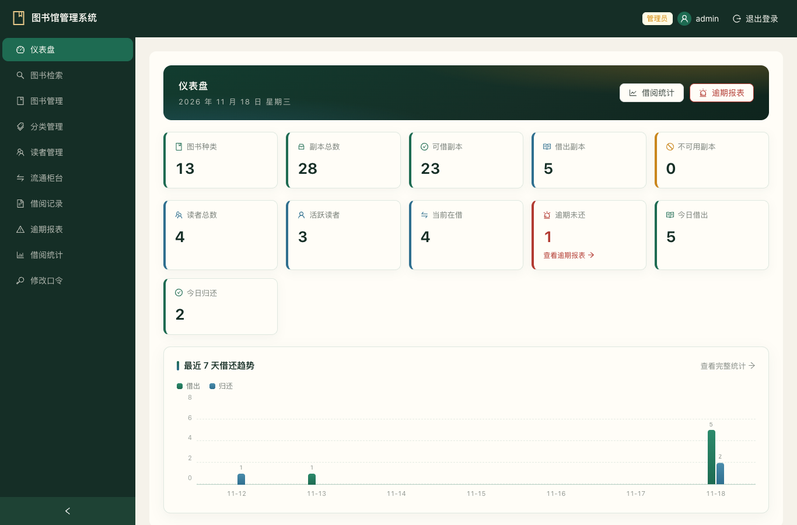
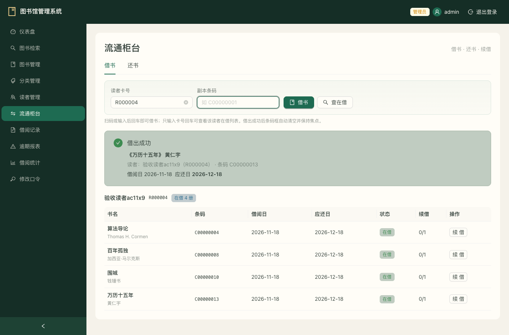
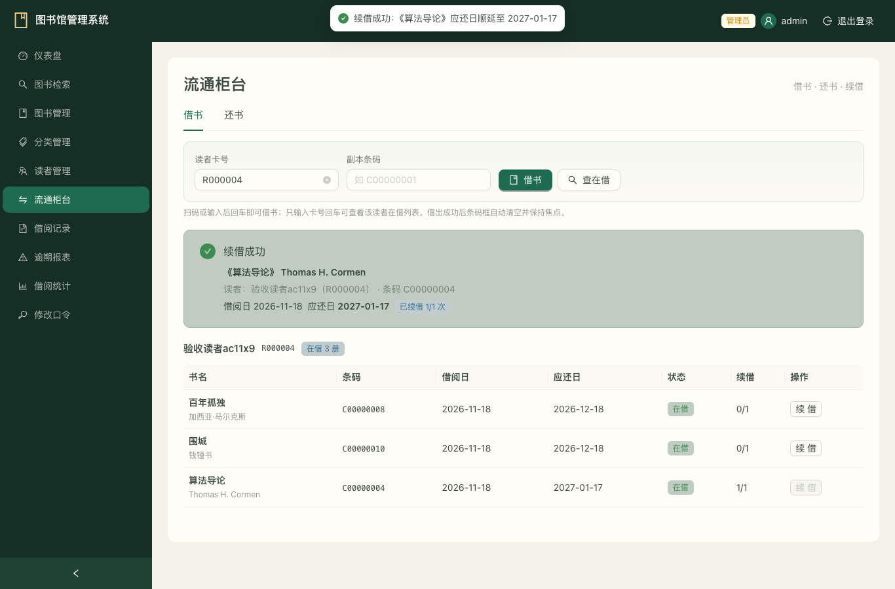
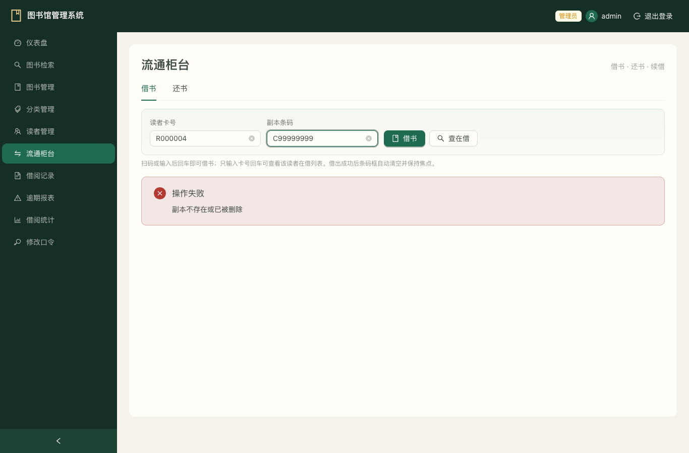
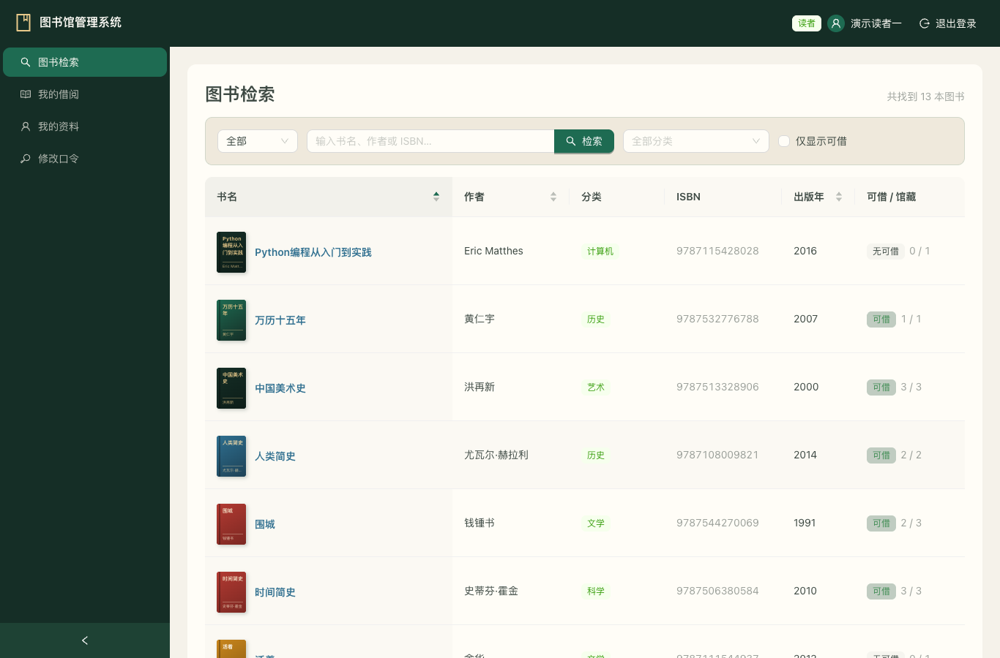
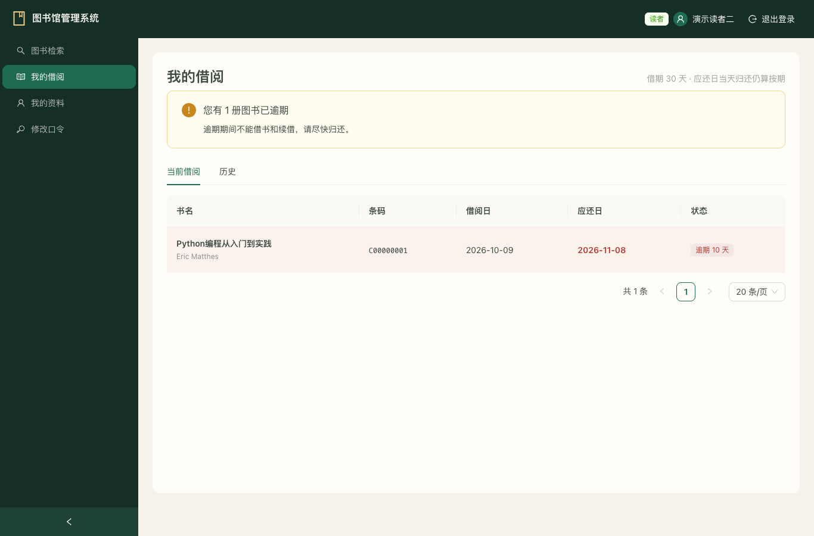
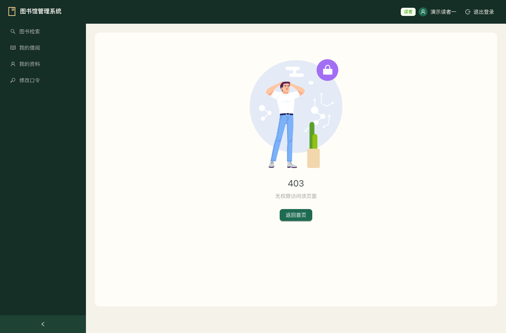
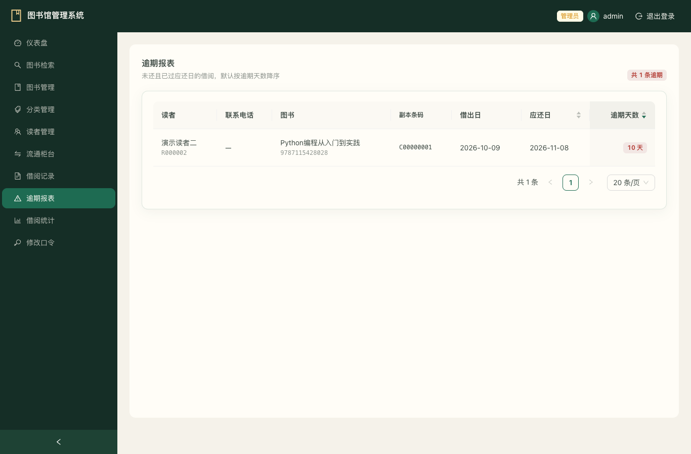

# 总结报告 Implementation Plan

> **For agentic workers:** REQUIRED SUB-SKILL: Use superpowers:subagent-driven-development (recommended) or superpowers:executing-plans to implement this plan task-by-task. Steps use checkbox (`- [ ]`) syntax for tracking.

**Goal:** 生成一份离线可用的单文件分层 HTML 总结报告 `docs/verification/summary-report.html`，讲清图书馆管理系统完成了什么、怎么完成的、如何证明完成得好，且每个数字都能追到证据文件。

**Architecture:** 手写一份源文件 `docs/verification/summary-report.src.html`（内联 CSS 与内联 SVG，截图用相对路径引用），再用一条一次性 node 命令把 8 张截图转成 base64 data URI，输出最终的 `summary-report.html`。先写一个核对脚本（放 `/tmp`），把事实表中的每个值作为断言；报告写完前它必然失败，写完后必须全部通过。

**Tech Stack:** 纯 HTML + CSS + SVG；node（`/opt/homebrew/bin/node`，只用内置模块）；Playwright chromium（复用 `frontend/node_modules`，不安装新包）做浏览器截图检查。

**设计依据：** `docs/verification/summary-report-design.md`（用户已批准）。

**全局约束（每个任务都适用）：**
- 只写 `docs/verification/` 下的文件和 `/tmp/report-*`。绝不写 `docs/design/**`、`README.md`、`backend/**`、`frontend/**`、`scripts/**`。
- 工作区不是 Git 仓库：本计划没有 commit 步骤，以“快照校验”代替（Task 9）。
- 不安装任何依赖；不重新运行测试；不访问网络。
- 报告里只出现 README 已公开的演示账号；不出现 Session、Token、Cookie 的值。

---

## 文件结构

| 文件 | 职责 |
|---|---|
| `/tmp/report-check.mjs` | 核对脚本：读取最终 HTML，断言事实表里的每个值都出现、无外部资源、8 张截图已内嵌。只用于本次构建，不保留在仓库 |
| `/tmp/report-shot.mjs` | 用 Playwright 打开最终 HTML，展开全部折叠，截全页图 |
| `docs/verification/summary-report.src.html` | 手写源文件：全部文字、表格、内联 SVG；截图以 `src="acceptance/screenshots/*.png"` 相对引用 |
| `docs/verification/summary-report.html` | 交付物：由源文件内嵌截图后得到的单文件 |
| `docs/verification/report-screenshots/summary-report-full.png` | 浏览器检查截图（证据） |

---

## 事实表（报告中所有数字的唯一来源；Task 8 逐项复核）

| # | 事实 | 值 | 来源文件 | 复核命令 |
|---|---|---|---|---|
| F1 | 候选 ID | `53beed1d7decfa898413faa45b9b1793b2d529c82f4127409b5524727c2ef1c7` | `docs/verification/candidate-snapshot.txt` | `grep -v '^#' docs/verification/candidate-snapshot.txt \| grep -v '^$' \| shasum -a 256` |
| F2 | 快照文件数 | 279 | 同上 | `grep -v '^#' docs/verification/candidate-snapshot.txt \| grep -vc '^$'` |
| F3 | AC 总数 / 通过 | 43 / 43 | `docs/design/ac-dod.md` §1；`docs/verification/acceptance/acceptance-report.md` | `sed -n '/^## 1\./,/^## 2\./p' docs/design/ac-dod.md \| grep -oE '^\| *\*?\*?AC-[A-Z]+-[0-9]+' \| sort -u \| wc -l` |
| F4 | AC 分组 | AUTH 11、CAT 1、BOOK 3、COPY 2、RDR 6、LOAN 8、SRCH 2、STAT 4、UI 6 | `docs/design/ac-dod.md` §1 | 同 F3 命令加 `sed -E 's/AC-([A-Z]+)-.*/\1/' \| uniq -c`（先去掉 `\| *\**`） |
| F5 | DoD 总数 / 通过 | 12 / 12 | `docs/design/ac-dod.md` §2；验收报告 | `sed -n '/^## 2\./,/^## 3\./p' docs/design/ac-dod.md \| grep -cE '^\| DOD-'` |
| F6 | 后端测试 | 515 个，0 failure，0 error，0 skipped | `docs/verification/acceptance/logs/acc-dod01-mvn-verify.log` | `grep 'Tests run: 515' docs/verification/acceptance/logs/acc-dod01-mvn-verify.log` |
| F7 | 前端测试 | 34 个文件，323 个用例全部通过 | `docs/verification/logs/t13-test-all-final.log` | `grep -E 'Test Files\|Tests ' docs/verification/logs/t13-test-all-final.log` |
| F8 | E2E | 8 个全部通过 | `docs/verification/acceptance/logs/acc-dod05-e2e.log` | `grep -E '8 passed' docs/verification/acceptance/logs/acc-dod05-e2e.log` |
| F9 | 验收缺陷数 | 0 | 验收报告 | 读 `acceptance-report.md` 结论段 |
| F10 | 并发场景 1 | 10 个并发请求借同一副本：1 个成功，9 个返回 COPY_NOT_AVAILABLE | `docs/verification/acceptance/logs/acc-concurrency-blackbox.txt` | `grep 'S1:' ...blackbox.txt` |
| F11 | 并发场景 2 | 同一读者并发借 8 本不同书：5 个成功，3 个返回超限 | 同上 | `grep '201=5' ...blackbox.txt` |
| F12 | 并发场景 3 | 同一借阅并发还两次：1 个成功，1 个返回 LOAN_ALREADY_RETURNED | 同上 | `grep 'S3:' ...blackbox.txt` |
| F13 | npm audit | 0 个漏洞 | `docs/verification/logs/t13-npm-audit.log` | `tail -1 docs/verification/logs/t13-npm-audit.log` |
| F14 | Java 8 拦截 | enforcer 报错：本项目要求 JDK 21 及以上 | `docs/verification/acceptance/logs/acc-dod01-java8.log` | `grep -c 'RequireJavaVersion' ...java8.log` |
| F15 | 端口 | 后端 18095、前端 15195；E2E 18096 / 15196 | `README.md` §5 | `grep -E '18095\|15195\|18096' README.md` |
| F16 | 后端版本 | Spring Boot 4.1.2、JDK 21、Hibernate 7.4.13、Flyway 12.4.0、sqlite-jdbc 3.53.4.0 | `backend/pom.xml`、`~/.m2` | `grep -A1 spring-boot-starter-parent backend/pom.xml` |
| F17 | 前端版本 | React 19.3、React Router 7.18、antd 6.7、TanStack Query 5.108、Vite 7.3、Vitest 5.1、Playwright 1.65、TypeScript 5.9 | `frontend/package.json` | `grep -E '"(react\|antd\|vite\|vitest\|@playwright/test\|typescript\|react-router\|@tanstack/react-query)"' frontend/package.json` |
| F18 | 业务规则 | 在借上限 5 本；借期 30 天；续借 1 次，从应还日顺延 30 天；只有管理员能续借；同一读者不能同时借同一书目的两个副本；ISBN 严格校验 | `docs/design/approval-record.md` §1 | 读 §1 |
| F19 | 演示数据 | 3 个演示读者（reader3 已停用）、5 个分类、12 本书、24 个副本、10 条借阅（1 条在借、1 条逾期、8 条已还） | `backend/data/library.db`（只读查询） | `sqlite3 -readonly backend/data/library.db "select count(*) from book; select count(*) from book_copy; select count(*) from loan;"` |

**环节与会话（报告第 2 层使用）：**

| 环节 | 模型 | 会话 ID | 结论 |
|---|---|---|---|
| 方案设计 | Ultimate | c0a55560-acd1-52f2-ae9c-fb56ae8f0f02 | design-v0.1 + AC/DoD v1，用户批准 |
| T01 后端基础与认证 | Qwen4-Max | b20275ae-4db2-50e3-ac69-692498036ccc | 完成（第 2 轮） |
| T02 前端基础工程 | Qwen4-Max | 00f68268-5dfc-5183-a2d9-b791a9668c0a | 完成 |
| T03 根目录脚本 | Qwen4-Max | a7feface-5aab-5a9c-a524-7f27aebf8a4b | 完成 |
| T04 分类/图书/副本接口 | Qwen4-Max | 90be31a4-2d7c-5a70-af27-230314e4e343 | 完成 |
| T05 读者接口 | Qwen4-Max | 5ac3b058-f05b-588b-a128-be8f7eecd788 | 完成 |
| T06 借阅/归还/续借接口 | Qwen4-Max | c066789b-3ef4-5e26-a7da-cccfb8479fd1 | 完成 |
| T07 统计与逾期报表接口 | Qwen4-Max | 9154df40-465e-5608-a337-22b1ac5659b3 | 完成 |
| T08 检索与馆藏管理页面 | Qwen4-Max | dae4c6f1-27a2-5913-a17f-ac7f1226b6f8 | 完成 |
| T09 读者管理与资料页面 | Qwen4-Max | 6ba34ce0-1437-50b0-ad70-713a402e75ae | 完成 |
| T10 流通柜台与借阅页面 | Qwen4-Max | 45b0479c-1a68-50dd-a244-e94e85c23374 | 完成 |
| T11 仪表盘与统计页面 | Qwen4-Max | 70c75d61-0686-5a5c-a022-cfbcca9e6563 | 完成 |
| T14 修改本人口令 | Qwen4-Max | 0ac87f6b-ed28-548b-a7ba-2b95c16584dc | 完成（遗留 I-08 交 T13） |
| T12 端到端冒烟 | Qwen4-Max | 90519310-b57c-52fb-a92f-790b49c216f8 | 8/8 通过，报告 E-01 |
| T13 最终集成 | Qwen4-Max | a00a1003-9a42-5419-a985-8818fd28a84b | 修复 I-01..I-09，生成候选 53beed1d |
| 独立评审 | Qwen4-Max | 63bcd8ec-d7fd-53d9-a712-cd4eefe52915 | PASS，0 阻断，7 非阻断 |
| 独立验收 | GLM-5.3 | 968bd6be-6ab0-57e7-abc9-fc43fbea0888 | 第 1 轮 BLOCKED，第 2 轮 PASS |
| 交付运维 | — | — | 未启用 |

---

### Task 1: 写核对脚本（先失败）

**Files:**
- Create: `/tmp/report-check.mjs`

- [ ] **Step 1: 写核对脚本**

```js
// /tmp/report-check.mjs — 断言最终报告包含事实表中的每个值，且离线自包含
import { readFileSync, existsSync } from 'node:fs';

const file = '/Users/duff/Documents/Lingma-Demo/qoder-pl-test10/docs/verification/summary-report.html';
if (!existsSync(file)) { console.error('FAIL: report not found'); process.exit(1); }
const html = readFileSync(file, 'utf8');

const mustContain = [
  ['F1 candidate', '53beed1d7decfa898413faa45b9b1793b2d529c82f4127409b5524727c2ef1c7'],
  ['F2 files', '279'],
  ['F3 AC', '43/43'],
  ['F5 DoD', '12/12'],
  ['F6 backend', '515'],
  ['F7 frontend', '323'],
  ['F7 files', '34'],
  ['F8 e2e', '8/8'],
  ['F10 conc1', 'COPY_NOT_AVAILABLE'],
  ['F12 conc3', 'LOAN_ALREADY_RETURNED'],
  ['F13 audit', '0 个漏洞'],
  ['F15 port be', '18095'],
  ['F15 port fe', '15195'],
  ['F16 boot', '4.1.2'],
  ['F16 hibernate', '7.4.13'],
  ['F16 flyway', '12.4.0'],
  ['F16 sqlite', '3.53.4.0'],
  ['F17 react', '19.3'],
  ['F17 antd', '6.7'],
  ['F17 vite', '7.3'],
  ['F17 playwright', '1.65'],
  ['sessions review', '63bcd8ec-d7fd-53d9-a712-cd4eefe52915'],
  ['sessions acc', '968bd6be-6ab0-57e7-abc9-fc43fbea0888'],
  ['layer1', 'id="what"'],
  ['layer2', 'id="how"'],
  ['layer3', 'id="proof"'],
  ['layer4', 'id="risks"'],
  ['appendix', 'id="evidence"'],
];
const acGroups = ['AUTH', 'CAT', 'BOOK', 'COPY', 'RDR', 'LOAN', 'SRCH', 'STAT', 'UI'];
const risks = ['R-01', 'I-04', 'I-06', 'I-07', 'R-04'];
const problems = ['I-02', 'I-05', 'I-08', 'I-09', 'E-01', 'BLOCKED', 'acc-admin.jar'];

let fails = 0;
const check = (label, ok) => { if (!ok) { fails++; console.error('FAIL', label); } };
for (const [label, s] of mustContain) check(label, html.includes(s));
for (const g of acGroups) check(`AC group ${g}`, html.includes(`AC-${g}`));
for (const r of risks) check(`risk ${r}`, html.includes(r));
for (const p of problems) check(`problem ${p}`, html.includes(p));

const external = html.match(/(?:src|href)\s*=\s*["']https?:\/\//gi) ?? [];
check(`no external src/href (found ${external.length})`, external.length === 0);
check('no <script src>', !/<script[^>]+src=/i.test(html));
const embedded = (html.match(/src="data:image\/png;base64,/g) ?? []).length;
check(`8 embedded screenshots (found ${embedded})`, embedded === 8);
check('no relative png src left', !/src="(?!data:)[^"]+\.png"/.test(html));
check('no secrets', !/JSESSIONID=|XSRF-TOKEN=[A-Za-z0-9-]/.test(html));

if (fails) { console.error(`${fails} check(s) failed`); process.exit(1); }
console.log('ALL CHECKS PASSED');
```

- [ ] **Step 2: 运行，确认失败**

Run: `/opt/homebrew/bin/node /tmp/report-check.mjs; echo "exit $?"`
Expected: `FAIL: report not found`，`exit 1`

---

### Task 2: 源文件骨架、样式与第 0 层摘要

**Files:**
- Create: `docs/verification/summary-report.src.html`

- [ ] **Step 1: 写骨架、CSS 和第 0 层**

```html
<!doctype html>
<html lang="zh-CN">
<head>
<meta charset="utf-8">
<meta name="viewport" content="width=device-width, initial-scale=1">
<title>图书馆管理系统首版 · 总结报告</title>
<style>
  :root { --ink:#1f2328; --muted:#59636e; --line:#d1d9e0; --bg:#f6f8fa; --pass:#1a7f37; --pass-bg:#dafbe1; --warn:#9a6700; --warn-bg:#fff8c5; --accent:#0969da; }
  * { box-sizing: border-box; }
  body { margin:0; font: 15px/1.65 -apple-system, "PingFang SC", "Hiragino Sans GB", "Microsoft YaHei", sans-serif; color:var(--ink); background:#fff; }
  main { max-width: 1120px; margin: 0 auto; padding: 32px 24px 64px; }
  h1 { font-size: 28px; margin: 0 0 4px; } h2 { font-size: 21px; margin: 0; } h3 { font-size: 17px; margin: 24px 0 8px; }
  .sub { color: var(--muted); margin: 0 0 24px; }
  code, .mono { font-family: ui-monospace, SFMono-Regular, Menlo, monospace; font-size: 13px; }
  .verdict { border:1px solid var(--pass); background:var(--pass-bg); border-radius:8px; padding:16px 20px; margin: 16px 0 24px; font-size:16px; }
  .cards { display:grid; grid-template-columns: repeat(6, 1fr); gap:12px; margin: 0 0 24px; }
  .card { border:1px solid var(--line); border-radius:8px; padding:12px; text-align:center; }
  .card b { display:block; font-size:24px; color:var(--pass); } .card span { color:var(--muted); font-size:13px; }
  table { border-collapse: collapse; width:100%; margin: 8px 0 16px; font-size:14px; }
  th, td { border:1px solid var(--line); padding:6px 10px; text-align:left; vertical-align: top; }
  th { background: var(--bg); }
  .pass { color: var(--pass); font-weight: 600; } .warn { color: var(--warn); font-weight: 600; }
  .tag-warn { background: var(--warn-bg); color: var(--warn); border-radius: 4px; padding: 0 6px; }
  details { border:1px solid var(--line); border-radius:8px; margin: 16px 0; }
  details > summary { cursor:pointer; padding: 14px 18px; background: var(--bg); border-radius: 8px; list-style: none; }
  details[open] > summary { border-bottom:1px solid var(--line); border-radius: 8px 8px 0 0; }
  details > .body { padding: 4px 20px 16px; }
  .shots { display:grid; grid-template-columns: repeat(2, 1fr); gap: 16px; }
  figure { margin:0; border:1px solid var(--line); border-radius:8px; overflow:hidden; }
  figure img { width:100%; display:block; } figcaption { padding:6px 10px; font-size:13px; color:var(--muted); }
  svg { max-width: 100%; height: auto; }
  .note { color: var(--muted); font-size: 13px; }
  @media print { details { break-inside: avoid; } .cards { grid-template-columns: repeat(3, 1fr); } }
</style>
<script>
  // 打印时展开全部折叠；这是唯一的内联脚本，无外部资源
  addEventListener('beforeprint', () => document.querySelectorAll('details').forEach(d => d.open = true));
</script>
</head>
<body>
<main>
  <h1>图书馆管理系统首版 · 总结报告</h1>
  <p class="sub">taskId lib-mgmt-20261117 ｜ 报告日期 2026-11-18 ｜ 绑定候选 <code>53beed1d7decfa898413faa45b9b1793b2d529c82f4127409b5524727c2ef1c7</code></p>

  <section id="summary">
    <div class="verdict"><b>结论：</b>同一候选上，<span class="pass">独立评审 PASS</span>（Qwen4-Max，0 个阻断问题）、<span class="pass">独立验收 PASS</span>（GLM-5.3，在干净克隆中只按 README 操作）。交付终点是“本机可运行的首版”；本报告不构成生产发布许可。</div>
    <div class="cards">
      <div class="card"><b>43/43</b><span>验收标准 AC</span></div>
      <div class="card"><b>12/12</b><span>完成定义 DoD</span></div>
      <div class="card"><b>515</b><span>后端测试全部通过</span></div>
      <div class="card"><b>323</b><span>前端测试全部通过（34 个文件）</span></div>
      <div class="card"><b>8/8</b><span>端到端 E2E</span></div>
      <div class="card"><b>0</b><span>验收发现的缺陷</span></div>
    </div>
    <p><b>候选 ID 是什么：</b>279 个源码文件逐一计算 sha256 后形成清单，候选 ID 是这份清单本身的 sha256。评审和验收都在开始与结束时校验它，保证两者检查的是同一份代码。</p>
    <h3>已知限制（均经独立评审同意放行）</h3>
    <ul>
      <li><span class="tag-warn">I-07</span> 读者被停用后，已登录的会话在过期前仍能访问部分只读页面；重新登录、借书、续借都会被拒绝。</li>
      <li><span class="tag-warn">I-04</span> 表单错误处理工具在 3 个功能模块中各有一份重复代码。</li>
      <li><span class="tag-warn">I-06</span> 前端主包约 898 KB，构建时有体积告警（不是错误）。</li>
      <li><span class="tag-warn">R-01</span> 登出时若有旧请求仍在途、且在重新登录后才返回 401，可能把新会话登出（安全方向，不泄露数据）。</li>
    </ul>
    <h3>如何启动与登录</h3>
    <p>在仓库根目录执行 <code>bash scripts/dev.sh</code>，打开 <code>http://localhost:15195</code>（后端端口 18095）。账号仅用于本地开发：</p>
    <table>
      <tr><th>账号</th><th>口令</th><th>角色与演示状态</th></tr>
      <tr><td><code>admin</code></td><td><code>Admin@12345</code></td><td>管理员</td></tr>
      <tr><td><code>reader1</code></td><td><code>Reader@123</code></td><td>读者，1 本在借</td></tr>
      <tr><td><code>reader2</code></td><td><code>Reader@123</code></td><td>读者，1 本逾期（逾期 10 天）</td></tr>
      <tr><td><code>reader3</code></td><td><code>Reader@123</code></td><td>读者，已停用（演示无法登录）</td></tr>
    </table>
  </section>

  <!-- LAYER-1 -->
  <!-- LAYER-2 -->
  <!-- LAYER-3 -->
  <!-- LAYER-4 -->
  <!-- APPENDIX -->
</main>
</body>
</html>
```

- [ ] **Step 2: 用浏览器直接打开源文件做一次目视检查**

Run: `open docs/verification/summary-report.src.html`
Expected: 标题、绿色结论框、6 张数字卡、限制列表、账号表正常显示。

---

### Task 3: 第 1 层“完成了什么”

**Files:**
- Modify: `docs/verification/summary-report.src.html`（替换 `<!-- LAYER-1 -->`）

- [ ] **Step 1: 写第 1 层**

用下面的内容替换 `<!-- LAYER-1 -->`：

```html
<details id="what">
<summary><h2>1 · 完成了什么</h2></summary>
<div class="body">
  <h3>按角色的功能</h3>
  <table>
    <tr><th>角色</th><th>菜单与功能</th></tr>
    <tr><td>管理员</td><td>仪表盘；图书检索；图书管理（新建、编辑、副本追加、改状态、删除）；分类管理；读者管理（新建读者同时创建账号、停用/启用、删除、重置口令）；流通柜台（借书、还书、续借，回车提交）；借阅记录（过滤、分页）；逾期报表；借阅统计（日/月粒度、热门图书）；修改口令</td></tr>
    <tr><td>读者</td><td>图书检索与详情（只显示可借数量，不显示条码）；我的借阅（当前/历史，逾期标红，无续借按钮）；我的资料；修改口令</td></tr>
  </table>
  <h3>业务规则（用户决定 D1–D7）</h3>
  <ul>
    <li>D1：每位读者同时在借上限 5 本；借期 30 天；可续借 1 次，从当前应还日顺延 30 天。</li>
    <li>D2：只有管理员能续借。</li>
    <li>D3：Spring Boot 4.1.x。</li>
    <li>D4：纳入“修改本人口令”；同一读者不能同时借同一书目的两个副本；ISBN 严格校验位检查。</li>
    <li>D5：后端 18095、前端 15195（E2E 用 18096 / 15196）；时区 Asia/Shanghai。</li>
    <li>D6：允许下载方案内依赖；新增依赖需用户批准。</li>
    <li>D7：技术栈为 Java Spring Boot + React + SQLite。</li>
    <li>非目标：预约、罚款、部署上线。</li>
  </ul>
  <h3>系统结构</h3>
  <svg viewBox="0 0 960 170" role="img" aria-label="系统结构图">
    <defs><marker id="a1" markerWidth="10" markerHeight="10" refX="9" refY="5" orient="auto"><path d="M0,0 L10,5 L0,10 z" fill="#59636e"/></marker></defs>
    <g font-size="13" font-family="sans-serif">
      <rect x="10" y="50" width="150" height="70" rx="8" fill="#f6f8fa" stroke="#d1d9e0"/><text x="85" y="80" text-anchor="middle">浏览器</text><text x="85" y="100" text-anchor="middle" fill="#59636e">管理员 / 读者</text>
      <rect x="220" y="50" width="190" height="70" rx="8" fill="#ddf4ff" stroke="#54aeff"/><text x="315" y="78" text-anchor="middle">React 19 + Vite（15195）</text><text x="315" y="98" text-anchor="middle" fill="#59636e">antd · TanStack Query · /api 代理</text>
      <rect x="470" y="30" width="260" height="110" rx="8" fill="#dafbe1" stroke="#4ac26b"/><text x="600" y="55" text-anchor="middle">Spring Boot 4.1.2（18095）</text><text x="600" y="78" text-anchor="middle" fill="#59636e">Security：会话 + CSRF + 角色</text><text x="600" y="98" text-anchor="middle" fill="#59636e">auth · catalog · reader · loan · stats</text><text x="600" y="118" text-anchor="middle" fill="#59636e">JPA / Hibernate 7.4.13 · JdbcClient</text>
      <rect x="790" y="50" width="160" height="70" rx="8" fill="#fff8c5" stroke="#d4a72c"/><text x="870" y="80" text-anchor="middle">SQLite</text><text x="870" y="100" text-anchor="middle" fill="#59636e">Flyway V1 迁移</text>
      <line x1="160" y1="85" x2="218" y2="85" stroke="#59636e" marker-end="url(#a1)"/>
      <line x1="410" y1="85" x2="468" y2="85" stroke="#59636e" marker-end="url(#a1)"/>
      <line x1="730" y1="85" x2="788" y2="85" stroke="#59636e" marker-end="url(#a1)"/>
    </g>
  </svg>
  <h3>数据模型</h3>
  <p><code>app_user</code> 1—1 <code>reader</code>（读者档案）；<code>category</code> 1—N <code>book</code>；<code>book</code> 1—N <code>book_copy</code>（副本，带条码与状态）；<code>reader</code> 1—N <code>loan</code>；<code>book_copy</code> 1—N <code>loan</code>（同一副本同时最多 1 条在借，由部分唯一索引保证）。</p>
  <h3>技术栈</h3>
  <table>
    <tr><th>后端</th><td>Spring Boot 4.1.2、JDK 21、Spring Security、Hibernate 7.4.13（社区 SQLite 方言）、Flyway 12.4.0、sqlite-jdbc 3.53.4.0、JUnit 5</td></tr>
    <tr><th>前端</th><td>React 19.3、React Router 7.18、antd 6.7、TanStack Query 5.108、Vite 7.3、TypeScript 5.9、Vitest 5.1、Playwright 1.65</td></tr>
  </table>
  <h3>演示数据</h3>
  <p>5 个分类、12 本书、24 个副本、3 个演示读者（reader3 已停用）、10 条借阅（1 条在借、1 条逾期、8 条已还）。</p>
  <h3>界面截图（独立验收时在真实浏览器中截取）</h3>
  <div class="shots">
    <figure><figcaption>管理员仪表盘</figcaption></figure>
    <figure><figcaption>流通柜台：借书后显示应还日</figcaption></figure>
    <figure><figcaption>流通柜台：续借，应还日顺延 30 天</figcaption></figure>
    <figure><figcaption>流通柜台：业务规则拒绝时的中文提示</figcaption></figure>
    <figure><figcaption>读者：图书检索</figcaption></figure>
    <figure><figcaption>读者：我的借阅，逾期标红</figcaption></figure>
    <figure><figcaption>读者访问管理页面显示 403</figcaption></figure>
    <figure><figcaption>逾期报表</figcaption></figure>
  </div>
</div>
</details>
```

- [ ] **Step 2: 目视检查**

Run: `open docs/verification/summary-report.src.html`，展开第 1 层。
Expected: 结构图 4 个方框、3 个箭头；8 张截图都能显示（相对路径）。

---

### Task 4: 第 2 层“怎么完成的”

**Files:**
- Modify: `docs/verification/summary-report.src.html`（替换 `<!-- LAYER-2 -->`）

- [ ] **Step 1: 写第 2 层**

```html
<details id="how">
<summary><h2>2 · 怎么完成的</h2></summary>
<div class="body">
  <h3>环节流水线</h3>
  <p>主会话负责调度和与用户沟通，每个环节在独立会话中执行，并由主会话独立复验结果后才进入下一步。不同环节使用不同模型，避免“自己检查自己”。</p>
  <table>
    <tr><th>环节</th><th>模型</th><th>会话 ID</th><th>结论</th></tr>
    <tr><td>方案设计</td><td>Ultimate</td><td class="mono">c0a55560-acd1-52f2-ae9c-fb56ae8f0f02</td><td>design-v0.1 与 AC/DoD v1，用户批准</td></tr>
    <tr><td>开发实现 T01–T14</td><td>Qwen4-Max</td><td>14 个会话，见下表</td><td>全部完成，主会话逐个复验</td></tr>
    <tr><td>独立评审</td><td>Qwen4-Max</td><td class="mono">63bcd8ec-d7fd-53d9-a712-cd4eefe52915</td><td class="pass">PASS（0 阻断，7 非阻断）</td></tr>
    <tr><td>独立验收</td><td>GLM-5.3</td><td class="mono">968bd6be-6ab0-57e7-abc9-fc43fbea0888</td><td>第 1 轮 BLOCKED，第 2 轮 <span class="pass">PASS</span></td></tr>
    <tr><td>交付运维</td><td>—</td><td>—</td><td>未启用（不部署）</td></tr>
  </table>
  <h3>任务拆解与依赖</h3>
  <svg viewBox="0 0 960 260" role="img" aria-label="任务依赖图">
    <defs><marker id="a2" markerWidth="8" markerHeight="8" refX="7" refY="4" orient="auto"><path d="M0,0 L8,4 L0,8 z" fill="#59636e"/></marker></defs>
    <g font-size="12" font-family="sans-serif" text-anchor="middle">
      <text x="10" y="20" text-anchor="start" fill="#59636e">后端（串行，共享工作区）</text>
      <g fill="#dafbe1" stroke="#4ac26b">
        <rect x="10" y="30" width="90" height="34" rx="6"/><rect x="130" y="30" width="90" height="34" rx="6"/><rect x="250" y="30" width="90" height="34" rx="6"/><rect x="370" y="30" width="90" height="34" rx="6"/><rect x="490" y="30" width="90" height="34" rx="6"/><rect x="610" y="30" width="90" height="34" rx="6"/>
      </g>
      <text x="55" y="52">T01 基础</text><text x="175" y="52">T04 馆藏</text><text x="295" y="52">T05 读者</text><text x="415" y="52">T06 借阅</text><text x="535" y="52">T07 统计</text><text x="655" y="52">T14 口令</text>
      <g stroke="#59636e" marker-end="url(#a2)"><line x1="100" y1="47" x2="128" y2="47"/><line x1="220" y1="47" x2="248" y2="47"/><line x1="340" y1="47" x2="368" y2="47"/><line x1="460" y1="47" x2="488" y2="47"/><line x1="580" y1="47" x2="608" y2="47"/></g>
      <text x="10" y="110" text-anchor="start" fill="#59636e">前端（T02 之后并行）</text>
      <g fill="#ddf4ff" stroke="#54aeff">
        <rect x="10" y="150" width="90" height="34" rx="6"/><rect x="160" y="120" width="90" height="30" rx="6"/><rect x="160" y="155" width="90" height="30" rx="6"/><rect x="160" y="190" width="90" height="30" rx="6"/><rect x="160" y="225" width="90" height="30" rx="6"/>
      </g>
      <text x="55" y="172">T02 基础</text><text x="205" y="140">T08 馆藏</text><text x="205" y="175">T09 读者</text><text x="205" y="210">T10 流通</text><text x="205" y="245">T11 统计</text>
      <g stroke="#59636e" marker-end="url(#a2)"><line x1="100" y1="160" x2="158" y2="135"/><line x1="100" y1="165" x2="158" y2="170"/><line x1="100" y1="172" x2="158" y2="205"/><line x1="100" y1="178" x2="158" y2="240"/></g>
      <rect x="370" y="150" width="90" height="34" rx="6" fill="#f6f8fa" stroke="#d1d9e0"/><text x="415" y="172">T03 脚本</text>
      <g fill="#fff8c5" stroke="#d4a72c"><rect x="760" y="110" width="90" height="34" rx="6"/><rect x="760" y="190" width="90" height="34" rx="6"/></g>
      <text x="805" y="132">T12 E2E</text><text x="805" y="212">T13 集成</text>
      <g stroke="#59636e" marker-end="url(#a2)"><line x1="700" y1="55" x2="758" y2="118"/><line x1="250" y1="190" x2="758" y2="130"/><line x1="460" y1="165" x2="758" y2="128"/><line x1="805" y1="144" x2="805" y2="188"/></g>
    </g>
  </svg>
  <p class="note">用户选择共享工作区，后端任务改为串行以避免同时编译同一工程（调度修订 plan-v1.1）；前端页面任务在不同目录写入，可以并行。</p>
  <table>
    <tr><th>任务</th><th>会话 ID</th><th>任务</th><th>会话 ID</th></tr>
    <tr><td>T01 后端基础与认证</td><td class="mono">b20275ae-4db2-50e3-ac69-692498036ccc</td><td>T08 检索与馆藏页面</td><td class="mono">dae4c6f1-27a2-5913-a17f-ac7f1226b6f8</td></tr>
    <tr><td>T02 前端基础工程</td><td class="mono">00f68268-5dfc-5183-a2d9-b791a9668c0a</td><td>T09 读者管理页面</td><td class="mono">6ba34ce0-1437-50b0-ad70-713a402e75ae</td></tr>
    <tr><td>T03 根目录脚本</td><td class="mono">a7feface-5aab-5a9c-a524-7f27aebf8a4b</td><td>T10 流通柜台页面</td><td class="mono">45b0479c-1a68-50dd-a244-e94e85c23374</td></tr>
    <tr><td>T04 分类/图书/副本接口</td><td class="mono">90be31a4-2d7c-5a70-af27-230314e4e343</td><td>T11 仪表盘与统计页面</td><td class="mono">70c75d61-0686-5a5c-a022-cfbcca9e6563</td></tr>
    <tr><td>T05 读者接口</td><td class="mono">5ac3b058-f05b-588b-a128-be8f7eecd788</td><td>T14 修改本人口令</td><td class="mono">0ac87f6b-ed28-548b-a7ba-2b95c16584dc</td></tr>
    <tr><td>T06 借阅/归还/续借接口</td><td class="mono">c066789b-3ef4-5e26-a7da-cccfb8479fd1</td><td>T12 端到端冒烟</td><td class="mono">90519310-b57c-52fb-a92f-790b49c216f8</td></tr>
    <tr><td>T07 统计与逾期报表接口</td><td class="mono">9154df40-465e-5608-a337-22b1ac5659b3</td><td>T13 最终集成</td><td class="mono">a00a1003-9a42-5419-a985-8818fd28a84b</td></tr>
  </table>
  <h3>关键决策与变更</h3>
  <ul>
    <li>用户追认 T02 额外引入的 4 个开发依赖（<code>@types/react</code>、<code>@types/react-dom</code>、<code>@types/node</code>、<code>@testing-library/dom</code>）。</li>
    <li>契约修订 R1：错误码表新增 <code>METHOD_NOT_ALLOWED</code>（HTTP 405），用户批准，前后端同步。</li>
    <li>集成待办 I-01..I-09 全部交给 T13：I-01/02/03/05/08/09 修复；I-04/06/07 记为已知限制。</li>
  </ul>
  <h3>问题与返工（按真实原因记录）</h3>
  <table>
    <tr><th>问题</th><th>现象</th><th>根因</th><th>处置</th><th>影响</th></tr>
    <tr><td>T01 首轮失败</td><td>第一轮未完成</td><td>未查明</td><td>第二轮完成，主会话复验 180 个测试通过</td><td>无</td></tr>
    <tr><td>I-02</td><td>用错请求方法时后端返回 500</td><td>异常处理器未区分“方法不支持”</td><td>新增 405 错误码（R1）并补回归测试</td><td>契约小修订</td></tr>
    <tr><td>I-08</td><td>前端全量测试 19 项失败</td><td>T02 写的路由测试仍断言“建设中”占位页</td><td>T13 改为断言真实页面，全量测试 0 失败</td><td>无</td></tr>
    <tr><td>I-09 / E-01</td><td>管理员登出后换读者登录，被带回管理页并显示 403</td><td>登出过程中三处组件之间存在竞态</td><td>T13 增加“主动登出”标志，先写失败测试再修复，浏览器确认</td><td>残余边界见 R-01</td></tr>
    <tr><td>I-05</td><td>借还后检索结果的可借数量不刷新</td><td>流通页面没有让馆藏数据缓存失效</td><td>T13 先写失败测试再修复，浏览器确认</td><td>无</td></tr>
    <tr><td>验收第 1 轮 BLOCKED</td><td>验收发现 1 个文件哈希与快照不符</td><td><b>主会话失误</b>：快照生成后修改了快照内的 <code>approval-record.md</code></td><td>恢复原字节（哈希复核一致），登记移到快照外的 <code>stage-results.md</code>，第 2 轮通过</td><td>评审结论不受影响（评审校验的是原字节）</td></tr>
    <tr><td>遗留文件 acc-admin.jar</td><td>工作区根目录多出 1 个 cookie 文件</td><td>验收脚本写到了授权范围之外</td><td>主会话移入验收证据目录（未删除）</td><td>只含已停止测试实例的 token，无凭据</td></tr>
  </table>
</div>
</details>
```

- [ ] **Step 2: 目视检查**

Run: `open docs/verification/summary-report.src.html`，展开第 2 层。
Expected: 依赖图中后端 6 个绿框串成一行、前端 T02 指向 4 个蓝框、T12→T13 竖向箭头；问题表 7 行。

---

### Task 5: 第 3 层“如何证明完成得好”

**Files:**
- Modify: `docs/verification/summary-report.src.html`（替换 `<!-- LAYER-3 -->`）

- [ ] **Step 1: 写第 3 层**

```html
<details id="proof">
<summary><h2>3 · 如何证明完成得好</h2></summary>
<div class="body">
  <h3>四层验证，绑定同一候选</h3>
  <svg viewBox="0 0 960 130" role="img" aria-label="分层验证图">
    <defs><marker id="a3" markerWidth="10" markerHeight="10" refX="9" refY="5" orient="auto"><path d="M0,0 L10,5 L0,10 z" fill="#59636e"/></marker></defs>
    <g font-size="13" font-family="sans-serif" text-anchor="middle">
      <rect x="10" y="20" width="200" height="70" rx="8" fill="#f6f8fa" stroke="#d1d9e0"/><text x="110" y="48">① 开发自测</text><text x="110" y="70" fill="#59636e">各任务的单元/集成/组件测试</text>
      <rect x="255" y="20" width="200" height="70" rx="8" fill="#f6f8fa" stroke="#d1d9e0"/><text x="355" y="48">② 主会话独立复跑</text><text x="355" y="70" fill="#59636e">test-all.sh 退出码 0</text>
      <rect x="500" y="20" width="200" height="70" rx="8" fill="#ddf4ff" stroke="#54aeff"/><text x="600" y="48">③ 独立评审</text><text x="600" y="70" fill="#59636e">Qwen4-Max，只读审查代码</text>
      <rect x="745" y="20" width="205" height="70" rx="8" fill="#dafbe1" stroke="#4ac26b"/><text x="847" y="48">④ 独立验收</text><text x="847" y="70" fill="#59636e">GLM-5.3，干净克隆 + README</text>
      <g stroke="#59636e" marker-end="url(#a3)"><line x1="210" y1="55" x2="253" y2="55"/><line x1="455" y1="55" x2="498" y2="55"/><line x1="700" y1="55" x2="743" y2="55"/></g>
      <text x="480" y="118" fill="#59636e">每一层开始和结束时都校验 279 个文件的快照：候选 53beed1d…c2ef1c7</text>
    </g>
  </svg>
  <h3>验收标准 AC：43/43 通过</h3>
  <table>
    <tr><th>分组</th><th>条数</th><th>覆盖内容</th><th>评审</th><th>验收</th></tr>
    <tr><td>AC-AUTH</td><td>11</td><td>登录、停用账号、未登录 401、授权矩阵、本人数据隔离、CSRF、登出、口令存储、跳转与 403、修改口令、初始管理员</td><td class="pass">PASS</td><td class="pass">PASS</td></tr>
    <tr><td>AC-CAT</td><td>1</td><td>分类增删改，名称忽略大小写去重</td><td class="pass">PASS</td><td class="pass">PASS</td></tr>
    <tr><td>AC-BOOK</td><td>3</td><td>图书创建（ISBN 严格校验）、删除前检查借阅历史、编辑</td><td class="pass">PASS</td><td class="pass">PASS</td></tr>
    <tr><td>AC-COPY</td><td>2</td><td>副本追加与条码生成、状态修改与删除规则</td><td class="pass">PASS</td><td class="pass">PASS</td></tr>
    <tr><td>AC-RDR</td><td>6</td><td>创建读者与账号、停用联动、删除规则、检索、重置口令、我的资料</td><td class="pass">PASS</td><td class="pass">PASS</td></tr>
    <tr><td>AC-LOAN</td><td>8</td><td>借书与应还日、6 类拒绝规则、并发、还书、续借、逾期判定、我的借阅、借阅列表过滤</td><td class="pass">PASS</td><td class="pass">PASS</td></tr>
    <tr><td>AC-SRCH</td><td>2</td><td>检索语义（模糊、ISBN、转义）、读者视角检索</td><td class="pass">PASS</td><td class="pass">PASS</td></tr>
    <tr><td>AC-STAT</td><td>4</td><td>概览、借还趋势（补零）、热门图书、逾期报表</td><td class="pass">PASS</td><td class="pass">PASS</td></tr>
    <tr><td>AC-UI</td><td>6</td><td>加载/空/错误/有数据四种状态、表单字段错误、错误码中文文案、柜台交互、续借按钮、统计页</td><td class="pass">PASS</td><td class="pass">PASS</td></tr>
  </table>
  <p class="note">逐条结果与证据位置见 <a href="ac-dod-matrix.md">ac-dod-matrix.md</a>（开发阶段）和 <a href="acceptance/acceptance-report.md">acceptance-report.md</a>（验收阶段）。</p>
  <h3>完成定义 DoD：12/12 通过</h3>
  <table>
    <tr><th>DoD</th><th>内容</th><th>核验者</th><th>结果</th><th>关键证据</th></tr>
    <tr><td>DOD-01</td><td>空克隆中构建；Java 8 被拒绝</td><td>验收</td><td class="pass">PASS</td><td>后端 515 个测试通过；enforcer 提示“本项目要求 JDK 21 及以上”</td></tr>
    <tr><td>DOD-02</td><td>dev.sh 启动、自动建库、停止、端口占用提示</td><td>验收</td><td class="pass">PASS</td><td><code>acceptance/logs/acc-dod02-*.log</code></td></tr>
    <tr><td>DOD-03</td><td>后端测试全部通过、无禁用测试</td><td>评审</td><td class="pass">PASS</td><td>515 个，0 failure，0 error，0 skipped</td></tr>
    <tr><td>DOD-04</td><td>前端 lint / 类型检查 / 测试 / 构建</td><td>评审</td><td class="pass">PASS</td><td>34 个文件 323 个用例通过</td></tr>
    <tr><td>DOD-05</td><td>E2E 七步冒烟，不碰开发库</td><td>验收</td><td class="pass">PASS</td><td>8/8 通过</td></tr>
    <tr><td>DOD-06</td><td>演示数据与初始管理员，重启不重复</td><td>验收</td><td class="pass">PASS</td><td>重启前后记录数不变</td></tr>
    <tr><td>DOD-07</td><td>README 可照做</td><td>验收</td><td class="pass">PASS</td><td>验收只按 README 完成全部操作</td></tr>
    <tr><td>DOD-08</td><td>安全</td><td>评审</td><td class="pass">PASS</td><td>见下方“高风险项”</td></tr>
    <tr><td>DOD-09</td><td>追溯矩阵完整</td><td>评审</td><td class="pass">PASS</td><td>43 条 AC + 12 条 DoD，无空项</td></tr>
    <tr><td>DOD-10</td><td>范围与依赖、无 REQUIRES_NEW、迁移未改</td><td>评审</td><td class="pass">PASS</td><td>只有 Flyway V1 且未修改</td></tr>
    <tr><td>DOD-11</td><td>独立评审通过</td><td>评审</td><td class="pass">PASS</td><td>0 个阻断问题</td></tr>
    <tr><td>DOD-12</td><td>独立验收通过且与评审同一快照</td><td>验收</td><td class="pass">PASS</td><td>开始/结束快照均 279/279</td></tr>
  </table>
  <h3>高风险项</h3>
  <table>
    <tr><th>风险</th><th>证明</th></tr>
    <tr><td>并发借还</td><td>验收黑盒复测：10 个并发请求借同一副本，1 个成功，9 个返回 <code>COPY_NOT_AVAILABLE</code>；同一读者并发借 8 本不同书，5 个成功，3 个因超限被拒；同一借阅并发还两次，1 个成功，1 个返回 <code>LOAN_ALREADY_RETURNED</code>。后端 <code>LoanConcurrencyTest</code> 在开发阶段连续多次通过。</td></tr>
    <tr><td>安全</td><td>口令以 BCrypt 存储，任何响应都不含口令；CSRF 防护；读者访问他人借阅返回 404；SQL 全部参数绑定；500 响应不暴露内部信息；日志不输出口令或 Token；npm audit 0 个漏洞；依赖版本在支持期内。</td></tr>
    <tr><td>时区与逾期</td><td>业务时区 Asia/Shanghai；应还日当天不算逾期；上海零点边界有专门测试。</td></tr>
  </table>
  <h3>如何自己复核</h3>
  <table>
    <tr><th>想确认</th><th>命令（在仓库根目录用 bash 执行）</th></tr>
    <tr><td>代码就是被评审和验收的那一份</td><td><code>grep -v '^#' docs/verification/candidate-snapshot.txt | grep -v '^$' &gt; /tmp/snap.txt &amp;&amp; shasum -a 256 -c /tmp/snap.txt | grep -vc ': OK$' &amp;&amp; shasum -a 256 /tmp/snap.txt</code>（第一个输出应为 0，第二个应等于候选 ID）</td></tr>
    <tr><td>全部测试</td><td><code>bash scripts/test-all.sh</code></td></tr>
    <tr><td>亲自操作</td><td><code>bash scripts/dev.sh</code>，然后打开 <code>http://localhost:15195</code></td></tr>
  </table>
</div>
</details>
```

- [ ] **Step 2: 目视检查**

Run: `open docs/verification/summary-report.src.html`，展开第 3 层。
Expected: 4 个方框的验证图；AC 表 9 行、DoD 表 12 行、全部绿色 PASS。

---

### Task 6: 第 4 层“遗留风险与建议”和附录“证据索引”

**Files:**
- Modify: `docs/verification/summary-report.src.html`（替换 `<!-- LAYER-4 -->` 与 `<!-- APPENDIX -->`）

- [ ] **Step 1: 替换 `<!-- LAYER-4 -->`**

```html
<details id="risks">
<summary><h2>4 · 遗留风险与建议</h2></summary>
<div class="body">
  <table>
    <tr><th>编号</th><th>内容</th><th>影响</th><th>建议</th><th>优先级</th></tr>
    <tr><td><span class="tag-warn">R-01</span></td><td>登出时若有旧请求在途、在重新登录后才返回 401，会把新会话登出</td><td>偶发体验问题，安全方向，无数据泄露</td><td>请求带“会话代际”标记，迟到的旧代际响应直接忽略</td><td>中</td></tr>
    <tr><td><span class="tag-warn">I-07</span></td><td>停用读者的已登录会话在过期前仍能读部分页面</td><td>只读、30 分钟内自然失效；借书续借已被拒</td><td>每个请求复查账号状态，或停用时注销会话</td><td>中</td></tr>
    <tr><td><span class="tag-warn">I-04</span></td><td>表单错误处理工具在 3 个模块中重复</td><td>维护成本</td><td>合并到共享层</td><td>低</td></tr>
    <tr><td><span class="tag-warn">I-06</span></td><td>前端主包约 898 KB</td><td>首屏加载稍慢（本机使用影响小）</td><td>按需拆分 antd 等大依赖</td><td>低</td></tr>
    <tr><td><span class="tag-warn">R-04</span></td><td>追溯矩阵中个别用例计数有偏差；README 写“两份”重复代码实际三份</td><td>描述不精确，不影响证据有效性</td><td>下一次改动时一并修正</td><td>低</td></tr>
  </table>
  <p>任何代码或文档改动都会产生新的候选：需要重新生成快照，并对受影响范围重新评审和验收。</p>
</div>
</details>
```

- [ ] **Step 2: 替换 `<!-- APPENDIX -->`**

```html
<details id="evidence">
<summary><h2>附录 · 证据索引</h2></summary>
<div class="body">
  <table>
    <tr><th>文件</th><th>证明什么</th></tr>
    <tr><td><a href="candidate-snapshot.txt">candidate-snapshot.txt</a></td><td>候选的 279 个文件及其 sha256</td></tr>
    <tr><td><a href="ac-dod-matrix.md">ac-dod-matrix.md</a></td><td>开发阶段每条 AC/DoD 的结果与证据位置</td></tr>
    <tr><td><a href="stage-results.md">stage-results.md</a></td><td>各环节结论登记</td></tr>
    <tr><td><a href="acceptance/acceptance-report.md">acceptance/acceptance-report.md</a></td><td>独立验收完整报告（43 + 12 行矩阵）</td></tr>
    <tr><td><a href="acceptance/logs/">acceptance/logs/</a></td><td>验收的构建、启动、E2E、并发日志</td></tr>
    <tr><td><a href="acceptance/screenshots/">acceptance/screenshots/</a></td><td>验收时的 16 张浏览器截图</td></tr>
    <tr><td><a href="logs/">logs/</a></td><td>T13 集成阶段的测试、审计、静态检查日志</td></tr>
    <tr><td><a href="screenshots/">screenshots/</a></td><td>T13 的 390px 布局与刷新修复截图</td></tr>
    <tr><td><a href="../design/solution-design.md">../design/solution-design.md</a></td><td>方案设计（契约 design-v0.1-R1）</td></tr>
    <tr><td><a href="../design/ac-dod.md">../design/ac-dod.md</a></td><td>验收标准与完成定义 v1</td></tr>
    <tr><td><a href="../design/approval-record.md">../design/approval-record.md</a></td><td>用户决定与集成待办</td></tr>
    <tr><td><a href="../../README.md">../../README.md</a></td><td>安装、启动、测试、账号、已知限制</td></tr>
  </table>
  <p class="note">本报告位于快照排除目录，写入它不会改变候选 ID。</p>
</div>
</details>
```

- [ ] **Step 3: 确认 5 个占位注释都已替换**

Run: `grep -c '<!-- LAYER\|<!-- APPENDIX' docs/verification/summary-report.src.html`
Expected: `0`

---

### Task 7: 内嵌截图，生成最终文件

**Files:**
- Create: `docs/verification/summary-report.html`

- [ ] **Step 1: 一次性内嵌命令**

```bash
cd /Users/duff/Documents/Lingma-Demo/qoder-pl-test10/docs/verification && /opt/homebrew/bin/node -e '
const fs = require("fs");
let html = fs.readFileSync("summary-report.src.html", "utf8");
let n = 0;
html = html.replace(/src="(acceptance\/screenshots\/[^"]+\.png)"/g, (_, p) => {
  n++; return `src="data:image/png;base64,${fs.readFileSync(p).toString("base64")}"`;
});
fs.writeFileSync("summary-report.html", html);
console.log("embedded", n, "bytes", Buffer.byteLength(html));
'
```

Expected: `embedded 8 bytes` 约 1,0xx,xxx（约 1 MB）。

- [ ] **Step 2: 运行核对脚本**

Run: `/opt/homebrew/bin/node /tmp/report-check.mjs; echo "exit $?"`
Expected: `ALL CHECKS PASSED`，`exit 0`。若有 FAIL，回到对应 Task 修改源文件后重新执行 Step 1、Step 2。

---

### Task 8: 事实复核（逐项对照来源文件）

**Files:** 无写入

- [ ] **Step 1: 重新从来源文件提取全部事实**

```bash
cd /Users/duff/Documents/Lingma-Demo/qoder-pl-test10
grep -v '^#' docs/verification/candidate-snapshot.txt | grep -v '^$' > /tmp/report-snap.txt
echo "F1 $(shasum -a 256 /tmp/report-snap.txt | cut -c1-64)"
echo "F2 $(wc -l < /tmp/report-snap.txt | tr -d ' ')"
echo "F3 $(sed -n '/^## 1\./,/^## 2\./p' docs/design/ac-dod.md | grep -oE '^\| *\*?\*?AC-[A-Z]+-[0-9]+' | sort -u | wc -l | tr -d ' ')"
sed -n '/^## 1\./,/^## 2\./p' docs/design/ac-dod.md | grep -oE '^\| *\*?\*?AC-[A-Z]+-[0-9]+' | sed -E 's/[^A-Z0-9-]//g' | sort -u | sed -E 's/AC-([A-Z]+)-.*/\1/' | uniq -c | tr '\n' ' '; echo
echo "F5 $(sed -n '/^## 2\./,/^## 3\./p' docs/design/ac-dod.md | grep -cE '^\| DOD-')"
grep 'Tests run: 515, Failures: 0, Errors: 0, Skipped: 0' docs/verification/acceptance/logs/acc-dod01-mvn-verify.log | tail -1
grep -E 'Test Files|Tests ' docs/verification/logs/t13-test-all-final.log | tail -2
grep -E '8 passed' docs/verification/acceptance/logs/acc-dod05-e2e.log
grep -E 'S1:|201=5|S3:' docs/verification/acceptance/logs/acc-concurrency-blackbox.txt
tail -1 docs/verification/logs/t13-npm-audit.log
grep -c 'RequireJavaVersion' docs/verification/acceptance/logs/acc-dod01-java8.log
grep -A1 spring-boot-starter-parent backend/pom.xml | grep version
grep -E '"(react|antd|vite|vitest|@playwright/test|typescript|react-router|@tanstack/react-query)"' frontend/package.json
sqlite3 -readonly backend/data/library.db "select 'books',count(*) from book; select 'copies',count(*) from book_copy; select 'categories',count(*) from category; select 'readers',count(*) from reader;"
```

Expected（与事实表一致）：F1 = `53beed1d…c2ef1c7`；F2 = 279；F3 = 43；分组 AUTH 11、BOOK 3、CAT 1、COPY 2、LOAN 8、RDR 6、SRCH 2、STAT 4、UI 6；F5 = 12；515 行存在；34 / 323；`8 passed`；三条并发结果；`found 0 vulnerabilities`；RequireJavaVersion ≥ 1；`4.1.2`；前端版本与 F17 一致；books 12、copies 24、categories 5、readers 3。

注意：演示数据计数取自当前开发库。用户测试期间可能新增了数据，如果计数大于事实表，报告保留“演示数据初始状态”的数值，并在 Step 2 记录差异原因，不改报告。

- [ ] **Step 2: 核对 AC 分组描述**

Run: `sed -n '/^## 1\./,/^## 2\./p' docs/design/ac-dod.md | grep -E '^\| *\*?\*?AC-' | cut -c1-120`
Expected：第 3 层 AC 表“覆盖内容”列中的每一项都能在对应 AC 的标题或描述里找到；找不到的项要改成 AC 原文的说法。

- [ ] **Step 3: 记录核对结果**

把 Step 1 输出与事实表逐项对比；任何不一致都要先修正 `summary-report.src.html`，再重新执行 Task 7。

---

### Task 9: 浏览器检查与最终交付校验

**Files:**
- Create: `/tmp/report-shot.mjs`
- Create: `docs/verification/report-screenshots/summary-report-full.png`

- [ ] **Step 1: 写截图脚本**

```js
// /tmp/report-shot.mjs — 打开最终报告，展开全部折叠，截全页图
import { createRequire } from 'node:module';
const require = createRequire('/Users/duff/Documents/Lingma-Demo/qoder-pl-test10/frontend/package.json');
const { chromium } = require('@playwright/test');

const root = '/Users/duff/Documents/Lingma-Demo/qoder-pl-test10/docs/verification';
const browser = await chromium.launch();
const page = await browser.newPage({ viewport: { width: 1280, height: 900 } });
const external = [];
page.on('request', r => { if (!r.url().startsWith('file:') && !r.url().startsWith('data:')) external.push(r.url()); });
await page.goto(`file://${root}/summary-report.html`);
await page.evaluate(() => document.querySelectorAll('details').forEach(d => (d.open = true)));
const broken = await page.evaluate(() => [...document.images].filter(i => !i.complete || i.naturalWidth === 0).length);
await page.screenshot({ path: `${root}/report-screenshots/summary-report-full.png`, fullPage: true });
await browser.close();
console.log(`external requests: ${external.length}; broken images: ${broken}`);
process.exit(external.length || broken ? 1 : 0);
```

- [ ] **Step 2: 运行截图并查看**

Run: `mkdir -p docs/verification/report-screenshots && /opt/homebrew/bin/node /tmp/report-shot.mjs; echo "exit $?"`
Expected: `external requests: 0; broken images: 0`，`exit 0`。然后用 Read 工具查看 `docs/verification/report-screenshots/summary-report-full.png`，确认版式、三张 SVG 图和 8 张截图正常。

- [ ] **Step 3: 候选快照与开发库最终校验**

```bash
cd /Users/duff/Documents/Lingma-Demo/qoder-pl-test10
shasum -a 256 -c /tmp/report-snap.txt 2>&1 | grep -vc ': OK$'
shasum -a 256 /tmp/report-snap.txt | cut -c1-64
find . -type f -not -path '*/node_modules/*' -not -path './backend/target/*' -not -path './frontend/dist/*' -not -path './frontend/test-results/*' -not -path './frontend/playwright-report/*' -not -path './backend/data/*' -not -path './docs/verification/*' -not -name '.DS_Store' | sed 's|^\./||' | sort | diff - <(awk '{print $2}' /tmp/report-snap.txt | sort); echo "tree diff $?"
```

Expected：第一行 `0`；第二行等于候选 ID；`tree diff 0`。三项都满足才算交付完成。

- [ ] **Step 4: 交付**

向用户报告：报告路径 `docs/verification/summary-report.html`、文件大小、核对脚本与浏览器检查结果、快照校验结果，以及任何 Task 8 中记录的差异。
